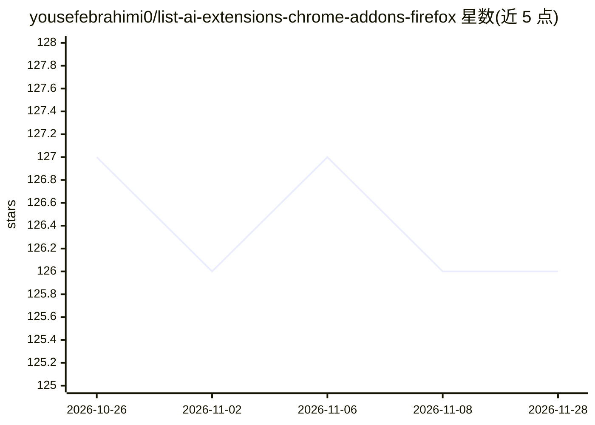

# yousefebrahimi0/list-ai-extensions-chrome-addons-firefox

⭐ 126 · Apache-2.0 · 推送 2026-11-23 · [GitHub](https://github.com/yousefebrahimi0/list-ai-extensions-chrome-addons-firefox) · 个人维护

**为浏览器用户整理的 Chrome/Firefox AI 扩展清单（64 条）**

一份按浏览器组织的 AI 扩展目录，收录 64 条 Chrome 扩展与 Firefox 附加组件，覆盖写作、摘要、搜索增强、网页抓取、会议转录等类别，每条附描述及商店下载链接。清单注明审计日期（2026-11-23）与验证方式：链接仅指向商店页面，不代表经过功能或安全测试；版本号仅在可对照官方商店快照时标注，并提示用户自行核查权限与隐私政策。清单还维护审计说明，记录移除与新增决策。

## 筛选速览

| 维度 | 判定 | 备注 |
|---|---|---|
| AI 角色 | `ai-knowledge` | 知识聚合/清单类 |
| 许可风险 | `permissive` | Apache-2.0 |
| 部署形态 | `None` |  |
| 模型依赖 | — | README 未给出锁定关系 |
| 硬件要求 | — | 无带数字的原话,不猜 |
| 安装摩擦 | `low` | 无编译、无系统依赖或容器化 |
| 成熟度 | — | 结构信号不足 |

## 能力要点

- 64 条 AI 浏览器扩展，附 Chrome/Firefox 商店下载链接
- 标注审计日期与版本验证口径（未验证≠v1）
- 维护审计说明，记录移除决策与安全验证限制
- 提示权限与隐私风险（如全站访问、邮件内容类扩展）

## 适用场景

- 为 Chrome/Firefox 挑选 AI 写作、摘要或搜索类扩展
- 按类别浏览当前可用的浏览器 AI 工具并直达商店页面
- 安装前参考清单中的权限与安全核查提示

## 场景标签

`精选清单` · 领域:学习与行业

## 证据(README 行号)

> L7:  64 curated AI browser extensions — updated 23 Nov 2026
> L14: **Audit date:** 23 November 2026. A Chrome/Firefox link points to a browser store; it does not guarantee the extens

## 星数曲线

2026-10-26 127 → 2026-11-28 126（-1）

---
*卡片 v1 · prompt 1.4 · 生成 2026-11-28 · 置信度 high · 依据 README sha `8424c4927bc3` · [字段定义](../../DATASET.md)*
