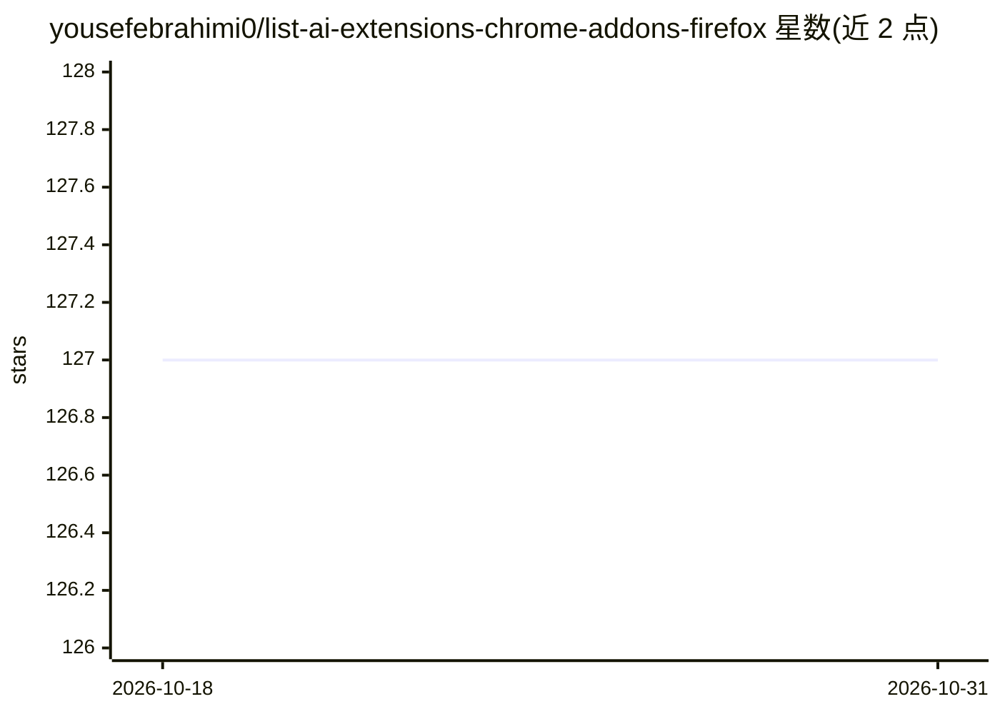

# yousefebrahimi0/list-ai-extensions-chrome-addons-firefox

⭐ 127 · MIT · 推送 2025-12-25 · [GitHub](https://github.com/yousefebrahimi0/list-ai-extensions-chrome-addons-firefox) · 个人维护

**60+ AI 浏览器扩展/插件策展清单（Chrome 与 Firefox）**

一份收录 60 余个 AI 功能浏览器扩展的清单，覆盖 Chrome 与 Firefox 双平台，条目以表格组织，含名称、功能描述与各平台下载链接。收录工具的用途包括摘要、写作辅助、网页抓取、验证码识别、转录、邮件生成等。清单最后更新于 2023 年 2 月 18 日，README 提示安装前注意扩展的权限。仓库本身不提供软件，仅提供条目索引与跳转链接。

## 筛选速览

| 维度 | 判定 | 备注 |
|---|---|---|
| AI 角色 | `ai-knowledge` | 知识聚合/清单类 |
| 许可风险 | `permissive` | MIT |
| 部署形态 | `None` |  |
| 模型依赖 | — | README 未给出锁定关系 |
| 硬件要求 | — | 无带数字的原话,不猜 |
| 安装摩擦 | `low` | 无编译、无系统依赖或容器化 |
| 成熟度 | — | 结构信号不足 |

## 能力要点

- 收录 60+ 个 AI 扩展，表格含 Chrome/Firefox 下载链接
- 覆盖摘要、写作、抓取、转录、邮件等多类用途
- 提示用户安装前关注扩展权限

## 适用场景

- 挑选带 AI 能力的 Chrome/Firefox 扩展
- 了解 2023 年前后 AI 浏览器扩展的工具分布

## 场景标签

`精选清单` · 领域:学习与行业

## 证据(README 行号)

> L7:  More than 60 AI Tools (updated 18 Feb. 2023)
> L8: A collection of software tools that utilize artificial intelligence (AI) technology to enhance the functionality and

## 星数曲线

2026-10-18 127 → 2026-10-31 127（+0）

---
*卡片 v1 · prompt 1.4 · 生成 2026-10-23 · 置信度 high · 依据 README sha `aba440b74e61` · [字段定义](../../DATASET.md)*
