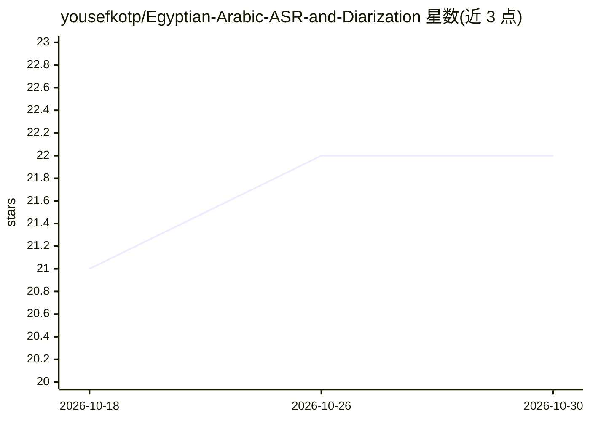

# yousefkotp/Egyptian-Arabic-ASR-and-Diarization

⭐ 22 · Jupyter Notebook · MIT · 推送 2026-03-09 · [GitHub](https://github.com/yousefkotp/Egyptian-Arabic-ASR-and-Diarization) · 组织维护

**面向埃及阿拉伯方言的语音识别模型与训练管线**

Speech Squad 团队参加 MTC-AIC 2 挑战的提交代码：基于 3200 万参数 FastConformer 架构、结合 CTC 与 RNN-T 训练埃及方言 ASR 模型，在测试集取得 9.58 的平均 Levenshtein 距离。四阶段管线为：先用 GPT-4o 生成文本、OpenAI TTS 合成约 3 万条语音做预训练（合成数据公开），再 CTC、RNN-T 训练，最后在适配数据上微调。面向语音研究开发者，提供 pip 安装、Python 推理接口与 NeMo 训练流程，需 SoX/libsndfile/FFmpeg 等系统依赖。

## 筛选速览

| 维度 | 判定 | 备注 |
|---|---|---|
| AI 角色 | `ai-native` | 本体是模型或模型工具 |
| 许可风险 | `permissive` | MIT |
| 部署形态 | `library` | 以包/库形式分发 |
| 模型依赖 | — | README 未给出锁定关系 |
| 硬件要求 | — | 无带数字的原话,不猜 |
| 安装摩擦 | `medium` | 含编译或系统依赖之一 |
| 成熟度 | — | 结构信号不足 |

## 能力要点

- FastConformer（32M 参数）+ CTC/RNN-T，测试集 MLD 9.59
- 四阶段训练：GPT-4o+OpenAI TTS 合成数据预训练→CTC→RNN-T→适配微调
- 公开约 30,000 条合成语音-文本对数据集
- 提供 pip 安装包与 Python 推理 API，权重约 130MB 自动下载

## 适用场景

- 转录埃及阿拉伯方言语音
- 复现或扩展竞赛 ASR 训练管线
- 获取埃及方言的合成 ASR 预训练数据

## 场景标签

`语音识别` `模型训练` · 领域:感知与多模态

## 证据(README 行号)

> L7: This repository is the submission from the Speech Squad team for the MTC-AIC 2 challenge. It contains the code for o

## 星数曲线

2026-10-18 21 → 2026-10-30 22（+1）

---
*卡片 v1 · prompt 1.4 · 生成 2026-10-27 · 置信度 mid · 依据 README sha `8d91fd77b3c4` · [字段定义](../../DATASET.md)*
