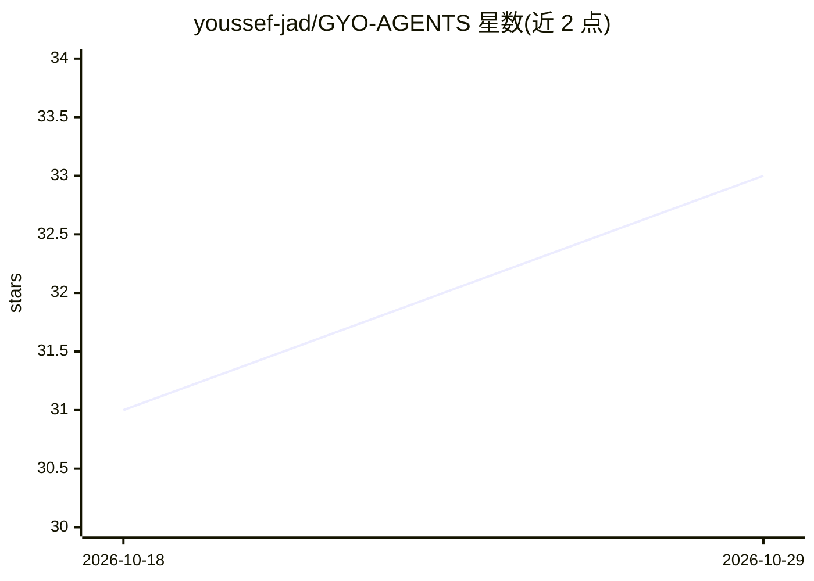

# youssef-jad/GYO-AGENTS

⭐ 33 · TypeScript · 推送 2026-07-03 · [GitHub](https://github.com/youssef-jad/GYO-AGENTS) · [官网](https://github.com/youssef-jad/GYO-AGENTS#readme) · 个人维护

**MCP 服务器+提示词：为 AI 编码代理生成 AGENTS.md 与共享持久记忆**

由 MCP 服务器与提示词两部分组成：服务器向 Cursor、Claude Code、Cline、Kiro、Windsurf 等 AI 编码工具暴露 24 个工具，包括 11 类提示词生成器、数字孪生持久记忆（跨仓库存于 ~/.gyo-agents/twin-memory.json，支持 memorize/forget/search）、智能与校验工具及配置自动同步；提示词部分可直接粘贴到代理中，分析代码库与 git 历史生成项目级 AGENTS.md。通过 npm 安装构建后接入各工具的 MCP 配置使用。

## 筛选速览

| 维度 | 判定 | 备注 |
|---|---|---|
| AI 角色 | `ai-ecosystem` | LLM/agent 周边工具 |
| 许可风险 | `none` | — |
| 部署形态 | `library` | 以包/库形式分发 |
| 模型依赖 | — | README 未给出锁定关系 |
| 硬件要求 | — | 无带数字的原话,不猜 |
| 安装摩擦 | `low` | 无编译、无系统依赖或容器化 |
| 成熟度 | — | 结构信号不足 |

## 能力要点

- MCP 服务器暴露 24 个工具（提示生成/记忆/校验/配置同步）
- 跨项目全局持久记忆存储于 ~/.gyo-agents/twin-memory.json
- 提供直接粘贴的提示词生成项目级 AGENTS.md
- 支持 Cursor、Claude Code、Cline、Kiro、Windsurf 等 AI 编码工具

## 适用场景

- 为 AI 编码代理生成项目级 AGENTS.md 指导文件
- 让多个 AI 编码工具共享我的编码偏好与经验记忆
- 随代码库演进自动同步代理配置

## 场景标签

`提示工程` `Agent 记忆` · 领域:Agent 开发

## 证据(README 行号)

> L5: Instead of copy-pasting prompts, connect the **GYO-AGENTS MCP Server** to any AI tool (Cursor, Claude Code, Cline, K
> L7: The server provides a global, persistent memory (`~/.gyo-agents/twin-memory.json`) that lives outside of any single 

## 星数曲线

2026-10-18 31 → 2026-10-29 33（+2）

---
*卡片 v1 · prompt 1.4 · 生成 2026-10-26 · 置信度 high · 依据 README sha `4b87fa3e334e` · [字段定义](../../DATASET.md)*
