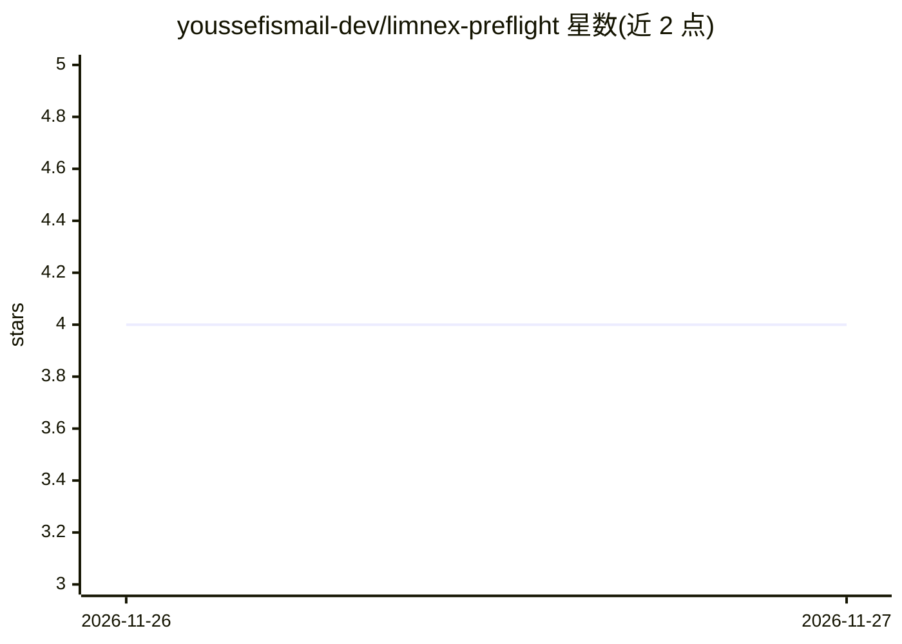

# youssefismail-dev/limnex-preflight

⭐ 4 · Python · Apache-2.0 · 推送 2026-11-24 · [GitHub](https://github.com/youssefismail-dev/limnex-preflight) · [官网](https://pypi.org/project/limnex-preflight/) · 个人维护

**发布前扫描 ML 模型文件中的密钥、个人信息与不安全 pickle**

面向发布模型文件的 Python CLI 与 GitHub Action：在推送到 Hugging Face、Kaggle 或 GitHub 前读取模型文件内部，检测密钥、个人数据与可执行 pickle。扫描全程不加载、不执行任何代码，扫描时无网络请求与遥测，报告仅输出掩码值。支持 PyTorch pickle、safetensors、GGUF、ONNX、Keras/HDF5、NumPy、notebook 及归档等格式，输出 SARIF/JSON 报告并定义 0-3 退出码。当前为 v0.1 alpha，未在真实恶意模型文件上测试。

## 筛选速览

| 维度 | 判定 | 备注 |
|---|---|---|
| AI 角色 | `ai-enhanced` | 去掉 AI 部分产品仍成立 |
| 许可风险 | `permissive` | Apache-2.0 |
| 部署形态 | `library` | 以包/库形式分发 |
| 模型依赖 | — | README 未给出锁定关系 |
| 硬件要求 | — | 无带数字的原话,不猜 |
| 安装摩擦 | `low` | 无编译、无系统依赖或容器化 |
| 成熟度 | `idea` | |

## 能力要点

- 静态分析 pickle 而不执行（pickletools + 符号栈，含永不执行的测试）
- 支持 PyTorch、safetensors、GGUF、ONNX、Keras/HDF5、NumPy、notebook、归档等格式
- 扫描时无网络与遥测，包零依赖，报告仅含掩码值与截断指纹
- 提供 GitHub Action 与 pre-commit 集成，SARIF 2.1.0 / JSON 输出

## 适用场景

- 把训练好的模型发布到 Hugging Face 前检查是否泄露密钥或个人数据
- 在 CI 流水线中阻断含不安全 pickle 的模型文件入库
- 排查训练框架写入模型文件中的用户名等隐私信息

## 场景标签

`网络安全` · 领域:学习与行业

## 证据(README 行号)

> L3: **Scan machine-learning files for secrets, personal data and unsafe pickles *before* you publish them to Hugging Fac
> L13: **Quick start:** `pip install limnex-preflight`, then `limnex-preflight path/to/model-or-folder`. Exit code 1 means
> L59: * **Nothing is ever loaded or executed.** Pickles are walked with `pickletools.genops` plus a small symbolic stack 

## 星数曲线

2026-11-26 4 → 2026-11-27 4（+0）

---
*卡片 v1 · prompt 1.4 · 生成 2026-11-26 · 置信度 high · 依据 README sha `9f7a8e809db1` · [字段定义](../../DATASET.md)*
