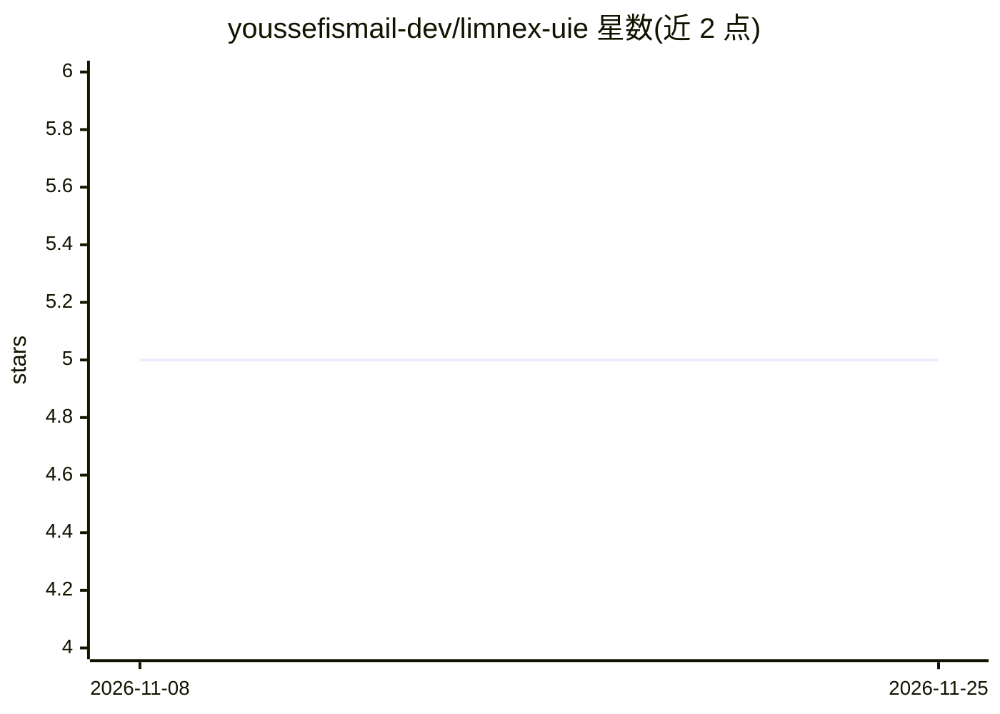

# youssefismail-dev/limnex-uie

⭐ 5 · Python · Apache-2.0 · 推送 2026-11-12 · [GitHub](https://github.com/youssefismail-dev/limnex-uie) · 个人维护

**从零训练的 URL 字符级生成模型，供防御性钓鱼研究合成样本**

一个 25.5M 参数的字符级 transformer，从零训练（无预训练模型、无词表、无模板），读取数百万真实 URL 后生成良性及钓鱼风格的合成 URL，并支持按类别对给定 URL 计算 log-likelihood 分数。所有生成必须经过已知 URL 过滤器（Bloom filter）剔除复现的训练样本；README 记录了门控评估（32 格中 29 格通过）、词表偏差与自由模式查询字符串两项已知局限，并声明仅用于防御研究、离线运行、不发布批量钓鱼数据。模型权重从 Releases 页下载，sha256 校验。

## 筛选速览

| 维度 | 判定 | 备注 |
|---|---|---|
| AI 角色 | `ai-native` | 本体是模型或模型工具 |
| 许可风险 | `permissive` | Apache-2.0 |
| 部署形态 | `library` | 以包/库形式分发 |
| 模型依赖 | — | README 未给出锁定关系 |
| 硬件要求 | — | 无带数字的原话,不猜 |
| 安装摩擦 | `low` | 无编译、无系统依赖或容器化 |
| 成熟度 | `idea` | |

## 能力要点

- 25.5M 参数字符级 transformer，从零训练，无预训练模型与模板
- 生成强制通过已知 URL 过滤器，sha256 校验模型与过滤器文件
- 提供 uie generate 与 uie score 命令行及 Python API
- 预注册门控评估：32 格中 29 格与真实样本不可区分（0.05 裕度内）

## 适用场景

- 为钓鱼检测器扩充训练数据以提升召回
- 在离线环境中研究钓鱼式 URL 的结构与模式
- 复现评估结果或对引擎做进一步基准测试

## 场景标签

`网络安全` `模型训练` · 领域:学习与行业

## 证据(README 行号)

> L7: Model: 25.5M parameters, trained from scratch
> L9: **A generative model of URLs, trained from scratch.** It reads millions of real
> L104:    urls = engine.generate("phishing", n=10, seed=7)   # always gated; see engine.report_text()

## 星数曲线

2026-11-08 5 → 2026-11-25 5（+0）

---
*卡片 v1 · prompt 1.4 · 生成 2026-11-20 · 置信度 high · 依据 README sha `a794b1f2110a` · [字段定义](../../DATASET.md)*
