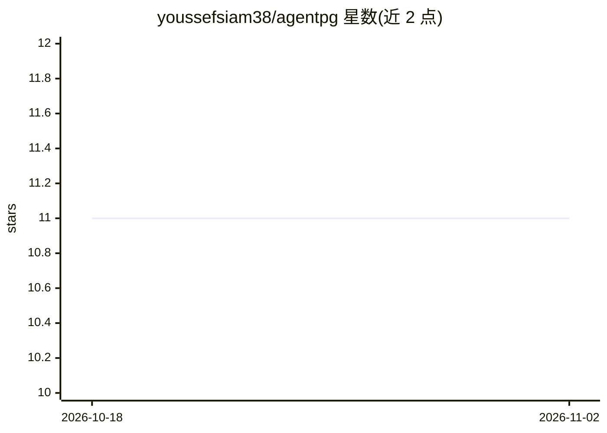

# youssefsiam38/agentpg

⭐ 11 · Go · MPL-2.0 · 推送 2026-03-16 · [GitHub](https://github.com/youssefsiam38/agentpg) · 个人维护

**Go 语言有状态 AI agent 框架，用 PostgreSQL 管理状态**

事件驱动的 Go 框架，用于构建异步 AI agent，以 PostgreSQL 作为状态管理与分发层。通过 LISTEN/NOTIFY 实现实时协调（带轮询回退），用 SELECT FOR UPDATE SKIP LOCKED 实现分布式 worker 的竞争安全任务认领，提供事务优先的原子 API。支持 Agent-as-tool 的多 agent 层级、批量与流式两种 API 模式、长对话的上下文自动压缩，并内嵌 HTMX 管理面板。集成 Claude API，面向 Go 开发者。以 go get 安装，MPL 2.0 许可。

## 筛选速览

| 维度 | 判定 | 备注 |
|---|---|---|
| AI 角色 | `ai-ecosystem` | LLM/agent 周边工具 |
| 许可风险 | `permissive` | MPL-2.0 |
| 部署形态 | `None` |  |
| 模型依赖 | locked-api |  |
| 硬件要求 | — | 无带数字的原话,不猜 |
| 安装摩擦 | `low` | 无编译、无系统依赖或容器化 |
| 成熟度 | — | 结构信号不足 |

## 能力要点

- PostgreSQL LISTEN/NOTIFY 事件驱动协调，轮询回退
- SKIP LOCKED 竞争安全的分布式 worker 任务认领
- Agent-as-tool 多 agent 层级与事务优先 API
- 批量/流式双 API 模式与自动上下文压缩

## 适用场景

- 用 Go 构建需要持久化状态的多 agent 系统
- 多实例部署下分布式执行 agent 任务
- 长对话场景下自动管理上下文窗口

## 场景标签

`Agent 框架` `多智能体` · 领域:Agent 开发

## 证据(README 行号)

> L3: AgentPG is a fully event-driven Go framework for building async AI agents using PostgreSQL for state management and 
> L7: - **Event-Driven Architecture**: PostgreSQL LISTEN/NOTIFY for real-time coordination with polling fallback

## 星数曲线

2026-10-18 11 → 2026-11-02 11（+0）

---
*卡片 v1 · prompt 1.4 · 生成 2026-11-01 · 置信度 high · 依据 README sha `6d7bfe09aebc` · [字段定义](../../DATASET.md)*
