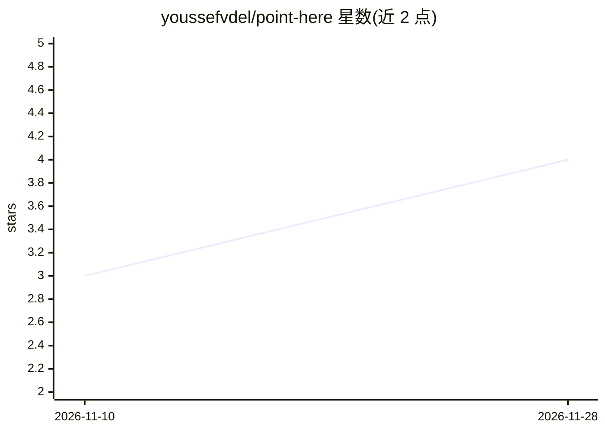

# youssefvdel/point-here

⭐ 4 · 推送 2026-11-10 · [GitHub](https://github.com/youssefvdel/point-here) · 个人维护

**给 AI 编程 agent 的技能与工具指针清单**

一份面向 AI 编码 agent 的资源指针清单，分三部分组织：agent skills（规则集与技能，如反套话设计、安全审计、极简编码指南）、UI 与动效库（shadcn/ui、Magic UI、Lenis 等）、开发工具与 MCP 服务器（搜索、音频感知、浏览器调试、本地语音/视觉）。用法是把仓库 URL 或 AGENTS.md 放入项目上下文，让 agent 按指令引用对应技能；社区可按行追加条目。

## 筛选速览

| 维度 | 判定 | 备注 |
|---|---|---|
| AI 角色 | `ai-knowledge` | 知识聚合/清单类 |
| 许可风险 | `none` | — |
| 部署形态 | `library` | 以包/库形式分发 |
| 模型依赖 | — | README 未给出锁定关系 |
| 硬件要求 | — | 无带数字的原话,不猜 |
| 安装摩擦 | `low` | 无编译、无系统依赖或容器化 |
| 成熟度 | — | 结构信号不足 |

## 能力要点

- 三类资源清单：agent 技能、UI/动效库、开发工具与 MCP 服务器
- 每条附 Quick Add 命令（npx skills add / npx shadcn add 等）
- 通过复制 AGENTS.md 使规则在会话间保留
- 支持向清单追加新工具条目

## 适用场景

- 给 Claude Code/Cursor 等 agent 指定设计品味与编码规范
- 为 agent 选择 React UI 组件库前先按 archetype 路由
- 为 agent 接入 MCP 服务器获得搜索、音频、浏览器等能力

## 场景标签

`精选清单` `编码 Agent` · 领域:编码与开发

## 证据(README 行号)

> L3: A pointer list for AI coding agents. Instead of telling an agent "make it look good" and hoping, you point it at the
> L11: Curated rulesets and skills designed to guide AI coding assistants (Claude Code, Cursor, Copilot, Codex, Gemini CLI
> L5: Drop the repo in the context, tell the agent **point here**, and it knows what to use.

## 星数曲线

2026-11-10 3 → 2026-11-28 4（+1）

---
*卡片 v1 · prompt 1.4 · 生成 2026-11-21 · 置信度 mid · 依据 README sha `323486e88ba1` · [字段定义](../../DATASET.md)*
