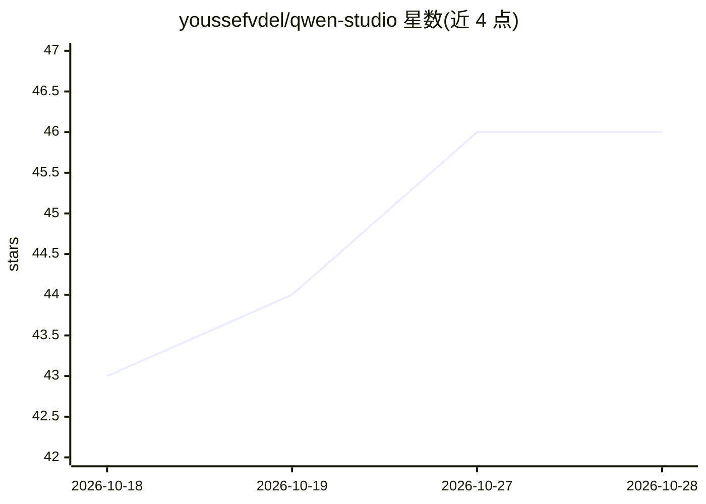

# youssefvdel/qwen-studio

⭐ 47 · Rust · 推送 2026-05-22 · [GitHub](https://github.com/youssefvdel/qwen-studio) · 个人维护 · 中文 README

**Linux 桌面端 Qwen 客户端：补齐官方 Windows/macOS 缺位**

基于 Tauri v2（Rust + WebKitGTK）的开源桌面应用，将 chat.qwen.ai 封装为 Linux 原生客户端，支持 Qwen3.6-Plus、Qwen-Max、Qwen-Plus 模型对话。核心机制：完整 MCP（Model Context Protocol）支持，预置 qwen-core（28 个工具）、文件系统、数据库查询等 MCP 服务器；qwen:// 深层链接处理认证；系统托盘、12 种语言、DEB/RPM 应用内自动更新。限制：存在 WebKitGTK 白屏、Wayland 部分兼容等已知问题，登录重定向在某些桌面环境受限。

## 筛选速览

| 维度 | 判定 | 备注 |
|---|---|---|
| AI 角色 | `ai-native` | 本体是模型或模型工具 |
| 许可风险 | `none` | — |
| 部署形态 | `desktop` | 安装包/桌面程序 |
| 模型依赖 | — | README 未给出锁定关系 |
| 硬件要求 | — | 无带数字的原话,不猜 |
| 安装摩擦 | `low` | 无编译、无系统依赖或容器化 |
| 成熟度 | — | 结构信号不足 |

## 能力要点

- Tauri v2 重构，二进制约 6MB，原生 Linux 集成
- 完整 MCP 支持，预置 qwen-core（28 工具）、数据库、文件系统等服务器
- DEB/RPM 应用内自动更新（启动检查 + 每 4 小时）
- 沙箱 WebView、无遥测、零数据收集

## 适用场景

- Linux 用户使用 Qwen 模型进行桌面端对话
- 通过 MCP 让 Qwen 连接本地文件、数据库与 shell 工具
- 需要在系统托盘常驻、支持多语言的 AI 聊天客户端

## 场景标签

`聊天机器人` · 领域:对话与助手

## 证据(README 行号)

> L8: Open-source Qwen AI desktop client for Linux. Run Alibaba's Qwen models natively with full MCP (Model Context Protoc
> L38: |Full Qwen AI access|Native desktop wrapper for chat.qwen.ai — supports Qwen3.6-Plus, Qwen-Max, Qwen-Plus|

## 星数曲线

2026-10-18 43 → 2026-10-28 46（+3）

---
*卡片 v1 · prompt 1.4 · 生成 2026-10-25 · 置信度 high · 依据 README sha `ef19575e858b` · [字段定义](../../DATASET.md)*
