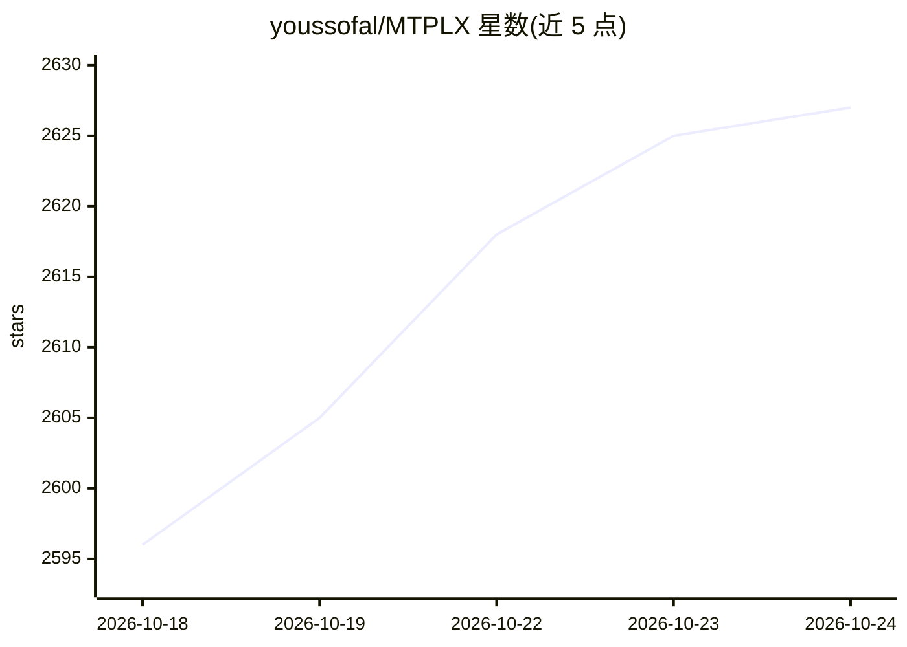

# youssofal/MTPLX

⭐ 2,627 · Python · Apache-2.0 · 推送 2026-10-10 · [GitHub](https://github.com/youssofal/MTPLX) · [官网](https://mtplx.com) · 个人维护

**在 Apple Silicon 上用模型自带 MTP 头运行本地 LLM 的 Mac 应用与 CLI**

MTPLX 是 macOS 原生应用加命令行工具，在 Apple Silicon 上运行 Qwen 3.8 系列、Ternary Bonsai 2 27B、Gemma 4 等本地模型，利用模型自带的多 token 预测（MTP）头做投机解码：模型向前起草多个 token，单次批处理前向验证，经精确拒绝采样提交，采样保持模型原生温度。提供 OpenAI 与 Anthropic 兼容的本地服务器，可接入 OpenCode、Claude Code、Cursor 等客户端。要求 Apple Silicon（M1 及以上）与 macOS 14+，按内存大小（16/32/96/128/256 GB 起）推荐不同量化档位的模型包。

## 筛选速览

| 维度 | 判定 | 备注 |
|---|---|---|
| AI 角色 | `ai-ecosystem` | LLM/agent 周边工具 |
| 许可风险 | `permissive` | Apache-2.0 |
| 部署形态 | `library` | 以包/库形式分发 |
| 模型依赖 | — | README 未给出锁定关系 |
| 硬件要求 | — | 无带数字的原话,不猜 |
| 安装摩擦 | `medium` | 含编译或系统依赖之一 |
| 成熟度 | — | 结构信号不足 |

## 能力要点

- 基于模型自带 MTP 头的精确投机解码，实测解码速度约为普通解码的两倍
- OpenAI 与 Anthropic 兼容本地服务器，供 OpenCode/Claude Code/Cursor 等客户端接入
- 提供 DMG 应用、Homebrew、pip 三种安装方式
- 按 Mac 内存档位给出模型推荐策略，覆盖 8 GB 至 256 GB 以上

## 适用场景

- 在 Mac 上本地运行 Qwen 3.8 27B/Flash Next 等模型进行编码辅助
- 为 Claude Code、OpenCode 等编程客户端提供本地模型后端
- 小内存 Mac（16 GB）上运行 Ternary Bonsai 2 27B 做带视觉的推理

## 场景标签

`推理引擎` · 领域:训练与推理

## 证据(README 行号)

> L11: MTPLX is a native Mac app and a command line that runs local language models on Apple Silicon with the model's own 
> L80: Then point OpenCode, Pi, Hermes, Claude Code, Cline, Cursor or anything that speaks the OpenAI or Anthropic API at 

## 星数曲线

2026-10-18 2,596 → 2026-10-24 2,627（+31）

---
*卡片 v1 · prompt 1.4 · 生成 2026-10-21 · 置信度 high · 依据 README sha `1e79bea46655` · [字段定义](../../DATASET.md)*
