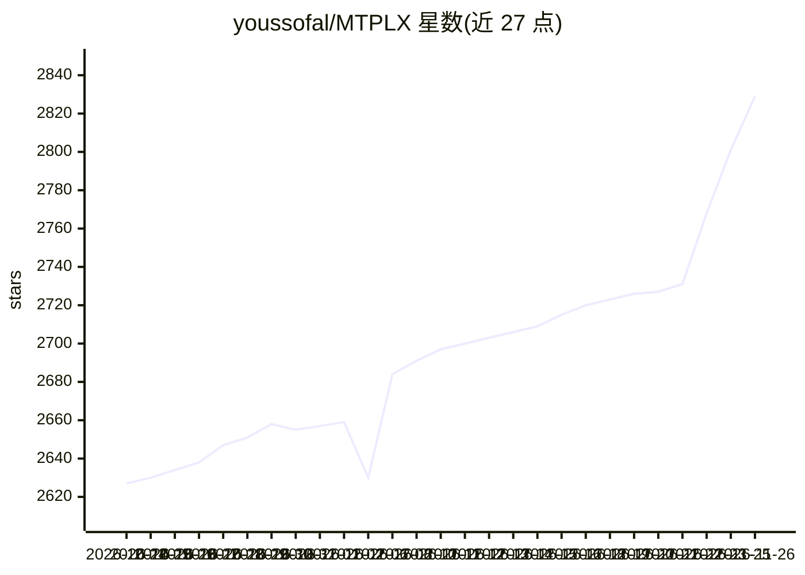

# youssofal/MTPLX

⭐ 2,829 · Python · Apache-2.0 · 推送 2026-11-24 · [GitHub](https://github.com/youssofal/MTPLX) · [官网](https://mtplx.com) · 个人维护

**Mac 用户在 Apple Silicon 上本地运行 LLM 的推理引擎**

提供 Mac 应用与命令行两种形态，使用模型自身的多 token 预测（MTP）头在 Apple Silicon 上运行本地语言模型，通过批量前向验证与拒绝采样实现投机解码。按机型芯片与统一内存推荐适配的模型包（含量化档位），自动下载模型并配置 Python 引擎、PATH 与解码深度。支持通过 OpenAI/Anthropic 兼容 API 接入 OpenCode、Claude Code 等客户端。硬件要求 Apple Silicon（M1 及以上）与 macOS 14+。

## 筛选速览

| 维度 | 判定 | 备注 |
|---|---|---|
| AI 角色 | `ai-ecosystem` | LLM/agent 周边工具 |
| 许可风险 | `permissive` | Apache-2.0 |
| 部署形态 | `library` | 以包/库形式分发 |
| 模型依赖 | — | README 未给出锁定关系 |
| 硬件要求 | — | 无带数字的原话,不猜 |
| 安装摩擦 | `medium` | 含编译或系统依赖之一 |
| 成熟度 | — | 结构信号不足 |

## 能力要点

- 基于模型自身 MTP 头的投机解码，带拒绝采样与残差校正
- Mac 应用按芯片与内存自动推荐并下载适配的模型包
- 提供 OpenAI 与 Anthropic 兼容的本地 API 端点
- brew 与 pip 两种 CLI 安装方式

## 适用场景

- 在 Mac 上本地运行 Qwen、Inkling 等开源模型
- 将本地模型接入 OpenCode、Claude Code、Cline 等编码客户端
- 按 Mac 内存选择合适的量化模型档位

## 场景标签

`推理引擎` · 领域:训练与推理

## 证据(README 行号)

> L11: MTPLX is a native Mac app and a command line that runs local language models on Apple Silicon with the model's own 
> L39: **The Mac app** is the easiest way in. Download the DMG at mtplx.com, drag it to Applications, and the app takes ca
> L83: Then point OpenCode, Pi, Hermes, Claude Code, Cline, Cursor or anything that speaks the OpenAI or Anthropic API at 

## 星数曲线

2026-10-24 2,627 → 2026-11-26 2,829（+202）

---
*卡片 v1 · prompt 1.4 · 生成 2026-11-23 · 置信度 high · 依据 README sha `795208acc91a` · [字段定义](../../DATASET.md)*
