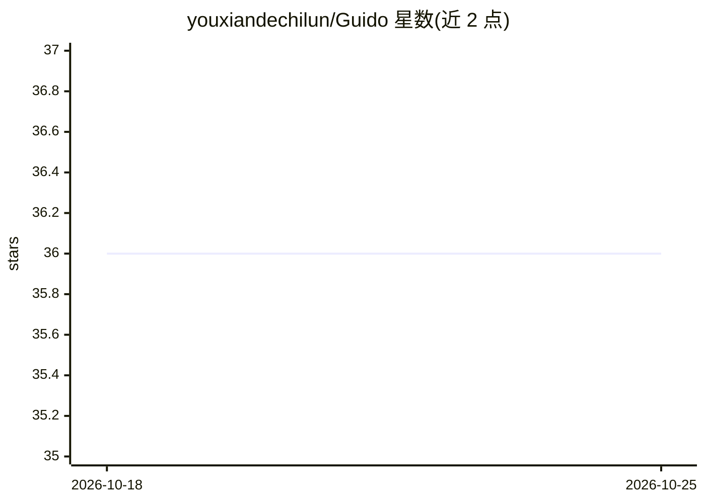

# youxiandechilun/Guido

⭐ 36 · Java · 推送 2026-07-11 · [GitHub](https://github.com/youxiandechilun/Guido) · 个人维护 · 中文 README

**景区导览 AI 数字人系统：多模态问答、本地 RAG 与路线推荐**

面向景区游客与运营人员的一体化智能导览系统，含 Spring Boot 后端、Vue 3 管理后台与 UniApp 游客端。为游客提供文本/语音问答、拍照识景（VLM）、引用溯源的本地 RAG 问答、兴趣标签路线推荐与 Canvas 数字导游 TTS 播报；为运营人员提供景区/知识库/AI 服务配置管理与情绪、命中率等数据看板。LLM/VLM 通过 OpenAI 或 Anthropic Compatible 适配器路由，凭据 AES-GCM 加密，Embedding 不可用时降级关键词检索。需 JDK 17、MySQL 8、Node.js 环境从源码启动，语音依赖阿里云 ASR/TTS。

## 筛选速览

| 维度 | 判定 | 备注 |
|---|---|---|
| AI 角色 | `ai-native` | 本体是模型或模型工具 |
| 许可风险 | `none` | — |
| 部署形态 | `library` | 以包/库形式分发 |
| 模型依赖 | — | README 未给出锁定关系 |
| 硬件要求 | — | 无带数字的原话,不猜 |
| 安装摩擦 | `medium` | 含编译或系统依赖之一 |
| 成熟度 | — | 结构信号不足 |

## 能力要点

- 本地 RAG：文档分片、向量化入 MySQL、余弦 Top-3 召回与关键词降级兜底
- SSE 流式链路：ASR/检索/LLM/TTS 分阶段事件与耗时记录
- LLM/VLM/Embedding/ASR/TTS 服务适配层，协议路由与连通性测试
- 兴趣标签路线推荐与四类情绪识别的运营分析看板

## 适用场景

- 游客在景区通过文字、语音或拍照获取带引用来源的导览讲解
- 运营人员维护景区知识库并查看热门问题、情绪与命中率趋势
- 按兴趣标签获取含推荐理由和预计时长的游览路线

## 场景标签

 · 领域:旅游/智能导览

## 证据(README 行号)

> L3: 面向景区游客与运营人员的一体化智能导览系统。项目将文本问答、语音交互、拍照识景、本地 RAG、个性化路线推荐和游客行为分析整合到同一业务中，并提供 UniApp 游客端、Vue 3 管理后台与 Spring Boot 后端服务。
> L20: - 设计“文本/语音输入 -> 本地 RAG 检索 -> 大模型生成 -> 语音合成 -> Canvas 数字导游播报”的交互链路，并接入图片识别能力。
> L30: |多模态导览|文本问答、语音问答、拍照识景、上下文会话与资料引用|

## 星数曲线

2026-10-18 36 → 2026-10-25 36（+0）

---
*卡片 v1 · prompt 1.4 · 生成 2026-10-25 · 置信度 mid · 依据 README sha `f92f287eed9f` · [字段定义](../../DATASET.md)*
