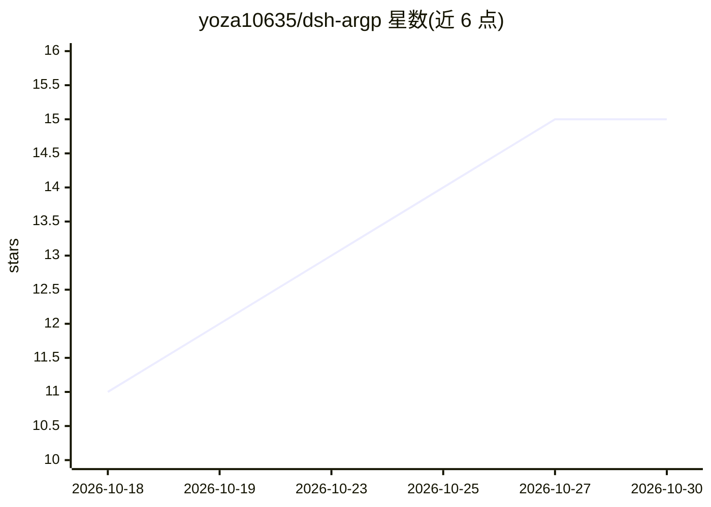

# yoza10635/dsh-argp

⭐ 15 · TypeScript · MIT · 推送 2026-10-26 · [GitHub](https://github.com/yoza10635/dsh-argp) · 个人维护 · 中文 README

**dsh 的第三方上下文压缩引擎插件：LLM 提议、守卫裁决**

DeepSeek Harness（dsh）的上下文压缩插件，替换摘要式压缩：Stage-1 每轮由 LLM 逐原子提案 extract/summary/false，确定性守卫按 verbatim 纪律裁决；Stage-2 在原子引用图上 0-LLM 反向拓扑剪枝，按字符口径收敛到预算；被压/被剪原文保留在 append-only 日志，可按 seq 召回（text 逐字，tool-call 参数 JSON 语义等价重建）。npm 安装即挂、默认双引擎全开，可退回纯 0-LLM 模式；附四臂对照等可复现实验脚本与已知限制（窗口截断盲区 B-6 等）。

## 筛选速览

| 维度 | 判定 | 备注 |
|---|---|---|
| AI 角色 | `ai-ecosystem` | LLM/agent 周边工具 |
| 许可风险 | `permissive` | MIT |
| 部署形态 | `None` |  |
| 模型依赖 | — | README 未给出锁定关系 |
| 硬件要求 | — | 无带数字的原话,不猜 |
| 安装摩擦 | `low` | 无编译、无系统依赖或容器化 |
| 成熟度 | — | 结构信号不足 |

## 能力要点

- LLM 提议 + 确定性守卫裁决的逐原子压缩（extract/summary/false）
- Stage-2 引用图 0-LLM 剪枝，三级触发（轮初/轮中压力/截断续写）
- append-only 日志承载原文，recall_summary/recall_detail 按需召回
- npm 安装即挂、默认双引擎，可用 peratom:false 退回纯图剪枝

## 适用场景

- 长会话 agent 编码任务中控制上下文窗口占用
- 需要保留并随时召回被压缩/被剪原文的场景
- 替代 dsh 原生摘要式压缩以保护精确 token 与缓存前缀

## 场景标签

 · 领域:LLM 基础设施/agent 工具

## 证据(README 行号)

> L11: **dsh-argp 是 DeepSeek Harness（dsh）的第三方上下文压缩引擎**：替换"让模型自由改写历史"的摘要式压缩——**LLM 只提方案、确定性守卫负责处置**，被压缩 / 被剪枝的原文保留在 append-
> L78: 从 npm 安装。**安装即挂、双引擎全开**：`peratom` 缺省 = 挂（默认值落在代码里、不受各层 patch 整块替换影响，见下文「Stage-1（双引擎）：缺省即挂」），Stage-1 三管线与 Stage-2 图引

## 星数曲线

2026-10-18 11 → 2026-10-30 15（+4）

---
*卡片 v1 · prompt 1.4 · 生成 2026-10-30 · 置信度 high · 依据 README sha `081f501fc369` · [字段定义](../../DATASET.md)*
