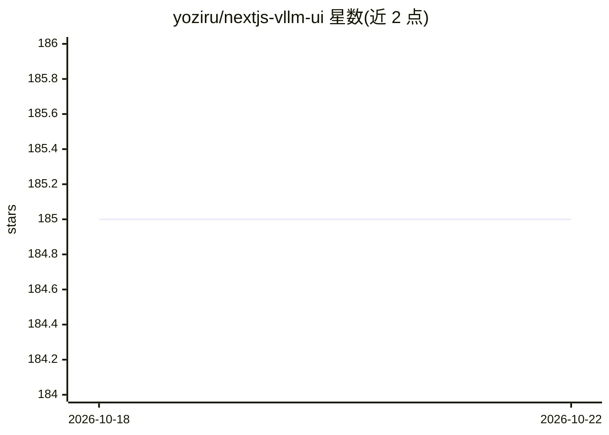

# yoziru/nextjs-vllm-ui

⭐ 185 · TypeScript · MIT · 推送 2026-08-10 · [GitHub](https://github.com/yoziru/nextjs-vllm-ui) · 个人维护

**面向 vLLM 与 Ollama 的自托管本地聊天 Web 界面**

基于 NextJS 构建的 Web 聊天界面，fork 自 nextjs-ollama-llm-ui，通过 OpenAI 兼容接口对接 vLLM 推理服务端，也可经 VLLM_URL 指向 Ollama。聊天记录存于浏览器 localstorage，无需数据库。提供预构建 Docker 镜像一键运行，也支持源码开发（Node.js 18+、mise、Aube 包管理）。UI 风格参照 ChatGPT，支持响应式、代码高亮与明暗模式。限制：需用户自行先运行 vLLM 或 Ollama 服务。

## 筛选速览

| 维度 | 判定 | 备注 |
|---|---|---|
| AI 角色 | `ai-ecosystem` | LLM/agent 周边工具 |
| 许可风险 | `permissive` | MIT |
| 部署形态 | `self-host` | docker 或自建部署 |
| 模型依赖 | local-ok | 支持本地模型 |
| 硬件要求 | — | 无带数字的原话,不猜 |
| 安装摩擦 | `low` | 无编译、无系统依赖或容器化 |
| 成熟度 | — | 结构信号不足 |

## 能力要点

- 通过 VLLM_URL 环境变量对接 vLLM 或 Ollama 服务
- 预构建 Docker 镜像单命令运行
- 聊天记录存 localstorage，无需数据库
- 响应式界面、代码高亮、明暗模式

## 适用场景

- 为自建的 vLLM 推理服务配一个网页聊天前端
- 本地/离线环境浏览和对话 LLM
- 手机等移动设备访问本地模型对话

## 场景标签

 · 领域:LLM 前端/WebUI

## 证据(README 行号)

> L5:  Fully-featured & beautiful web interface for vLLM & Ollama
> L29: 1. Download vLLM and have it running. Or run it in a Docker container.
> L37: docker run --rm -d -p 3000:3000 -e VLLM_URL=http://host.docker.internal:8000 ghcr.io/yoziru/nextjs-vllm-ui:latest

## 星数曲线

2026-10-18 185 → 2026-10-22 185（+0）

---
*卡片 v1 · prompt 1.4 · 生成 2026-10-22 · 置信度 high · 依据 README sha `3ba4d5213634` · [字段定义](../../DATASET.md)*
