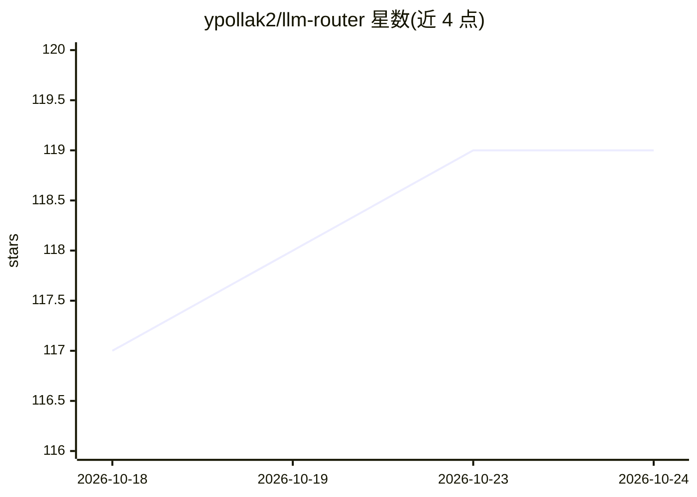

# ypollak2/llm-router

⭐ 119 · Python · MIT · 推送 2026-10-23 · [GitHub](https://github.com/ypollak2/llm-router) · 个人维护

**为 AI 编程工具跨免费/付费模型分层路由的本地路由器**

面向 Claude Pro/Max 等订阅用户的本地 LLM 路由器：通过 MCP 钩子在编码工具（Claude Code、Codex CLI、Cursor、Gemini CLI、Copilot 等 15+ host）处理 prompt 前拦截，用正则启发式分类，先由免费或本地模型（Ollama）起草回答，必要时沿免费→预算→付费链路升级。默认草稿仅作建议，Claude 仍接管回合，需 LLM_ROUTER_ZERO_CLAUDE=1 才替代。含密钥检测仅走本地、熔断降级、verified/unverified 分开统计的节省报告；本地直执行仅靠静态 tripwire 而非沙箱。以 pip 包提供，另有 Python 进程内 API。

## 筛选速览

| 维度 | 判定 | 备注 |
|---|---|---|
| AI 角色 | `ai-ecosystem` | LLM/agent 周边工具 |
| 许可风险 | `permissive` | MIT |
| 部署形态 | `library` | 以包/库形式分发 |
| 模型依赖 | local-ok | 支持本地模型 |
| 硬件要求 | — | 无带数字的原话,不猜 |
| 安装摩擦 | `low` | 无编译、无系统依赖或容器化 |
| 成熟度 | — | 结构信号不足 |

## 能力要点

- 免费优先分层路由：先免费/本地模型起草，按需升级到付费模型
- 支持 15+ 编码工具 host（Claude Code/Codex/Cursor/Gemini CLI/Copilot 等）
- 无 API key 即可在 Claude 订阅上运行，路由经 MCP 工具与本地模型
- 密钥/令牌命中的 prompt 仅路由到本地模型（fail-closed）

## 适用场景

- Claude 订阅 5 小时额度被低价值 prompt 消耗时把简单问题路由到免费模型
- 在 Cursor/Codex 等工具中自动降级到 Ollama 等免费后端以压低成本
- 通过 status/sessions 命令查看分层节省与各 provider 延迟成本

## 场景标签

 · 领域:LLM 基础设施/模型路由

## 证据(README 行号)

> L7:  llm-router hooks into your coding tool's own lifecycle, reads each prompt before the
> L99: Hooks intercept the prompt before your coding tool's own model sees it. A free
> L133: |Providers|Free-first — Ollama (local), OpenRouter, Gemini, Groq, your Claude subscription|guide/PROVIDERS.md|

## 星数曲线

2026-10-18 117 → 2026-10-24 119（+2）

---
*卡片 v1 · prompt 1.4 · 生成 2026-10-23 · 置信度 high · 依据 README sha `906581fcc7eb` · [字段定义](../../DATASET.md)*
