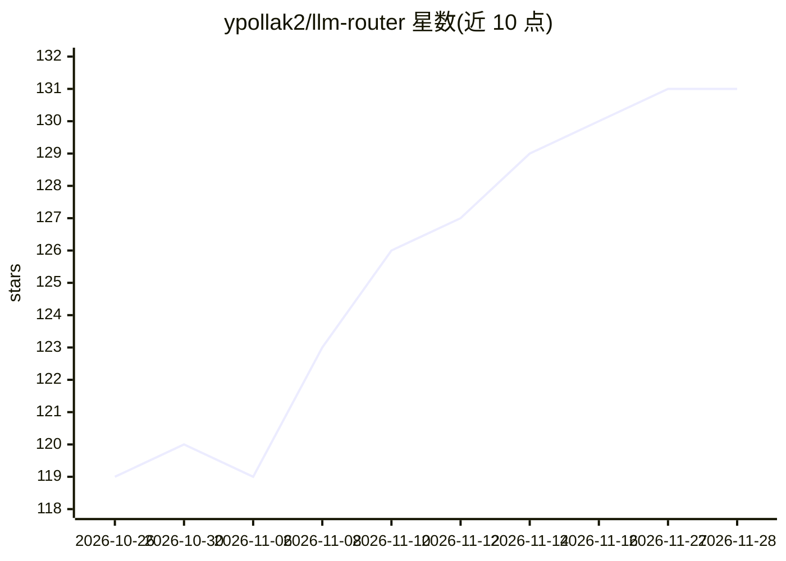

# ypollak2/llm-router

⭐ 131 · Python · MIT · 推送 2026-11-27 · [GitHub](https://github.com/ypollak2/llm-router) · 个人维护

**为 AI 编码工具接入免费/本地模型的路由器，降低订阅配额消耗**

以 hook 方式挂接 Claude Code 等 AI 编码工具的生命周期，在宿主模型读取 prompt 前拦截，先用免费或本地模型生成草稿答案，必要时沿 fallback 链上升至付费模型；默认草稿仅为提示，宿主模型仍执行本回合。免费优先策略针对订阅用户（无需 API key，路由经 MCP 工具与本地模型），含熔断 fallback、密钥安全路由、grounding check、本地运行统计与节省报告。面向个人开发者与小团队；团队策略/SSO 等指向独立产品 Chuzom。

## 筛选速览

| 维度 | 判定 | 备注 |
|---|---|---|
| AI 角色 | `ai-ecosystem` | LLM/agent 周边工具 |
| 许可风险 | `permissive` | MIT |
| 部署形态 | `library` | 以包/库形式分发 |
| 模型依赖 | local-ok | 支持本地模型 |
| 硬件要求 | — | 无带数字的原话,不猜 |
| 安装摩擦 | `low` | 无编译、无系统依赖或容器化 |
| 成熟度 | — | 结构信号不足 |

## 能力要点

- hook 拦截 prompt，先由免费/本地模型起草，按需沿链路升到付费模型
- 订阅场景无需 API key，路由经 MCP 工具与本地模型
- 含密钥的安全路由仅发往 loopback 本地 Ollama，并有 grounding check 丢弃无依据草稿
- 支持 15 个宿主安装（Claude Code/Codex/Cursor/Gemini CLI 等）与熔断 fallback

## 适用场景

- Claude Pro/Max 订阅用户减少五小时配额被简单问题耗尽
- 让含 API 密钥的 prompt 只经本地模型处理
- 在多宿主编码工具间统一免费优先的模型路由策略

## 场景标签

`模型网关` · 领域:Agent 开发

## 证据(README 行号)

> L5:  llm-router hooks into your coding tool's own lifecycle, reads each prompt before the
> L67: Python agents route in-process, no server: `from llm_router import Router; r = Router(budget_usd=0.50).run("...")` 
> L140: |Providers|Free-first — Ollama (local), OpenRouter, Gemini, Groq, your Claude subscription|guide/PROVIDERS.md|

## 星数曲线

2026-10-26 119 → 2026-11-28 131（+12）

---
*卡片 v1 · prompt 1.4 · 生成 2026-11-28 · 置信度 high · 依据 README sha `df936606e8cf` · [字段定义](../../DATASET.md)*
