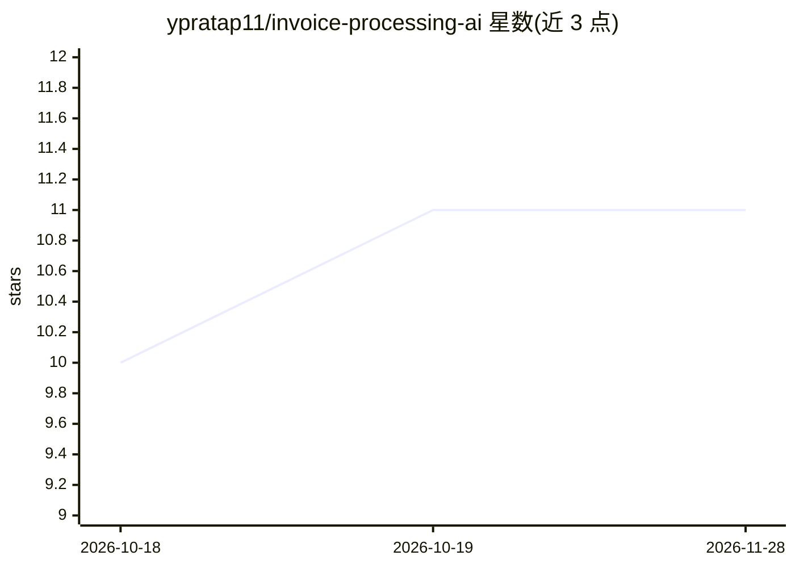

# ypratap11/invoice-processing-ai

⭐ 11 · Python · 推送 2026-11-24 · [GitHub](https://github.com/ypratap11/invoice-processing-ai) · 个人维护

**面向企业财务的发票结构化提取系统（Google Document AI）**

基于 Google Document AI 的发票处理系统：Streamlit 前端上传，FastAPI 后端调用 Document AI 提取供应商、日期、金额与行项目，附逐字段置信度展示与算术校验（行项目+税额须等于总额，否则转人工复核），支持单张与批量处理（最多10份）。README 含对 53 张标注发票的审计：修复后 6/53 全对，49/53 送人工复核，测试集多为合成数据。需 Google Cloud Document AI 账户；提供 Docker/K8s/Helm 部署。

## 筛选速览

| 维度 | 判定 | 备注 |
|---|---|---|
| AI 角色 | `ai-native` | 本体是模型或模型工具 |
| 许可风险 | `none` | — |
| 部署形态 | `self-host` | docker 或自建部署 |
| 模型依赖 | — | README 未给出锁定关系 |
| 硬件要求 | — | 无带数字的原话,不猜 |
| 安装摩擦 | `low` | 无编译、无系统依赖或容器化 |
| 成熟度 | `idea` | |

## 能力要点

- 调用 Google Document AI 提取发票字段并展示逐字段置信度
- 算术校验：行项目+税额不等于总额时转人工复核
- 支持 PDF/PNG/JPG/TIFF/GIF 等格式与批量处理（≤10份）
- README 附 53 张标注发票的实测审计数据

## 适用场景

- 把应付账款流程中的手工录入换成结构化提取
- 低置信度字段路由给人工复核，减少逐字段核对
- 把提取结果接入会计系统的数据管道

## 场景标签

`文档解析` · 领域:知识与检索

## 证据(README 行号)

> L14: An end-to-end AI-powered invoice processing system that automates document processing for enterprises. Built for te
> L43: - **Google Document AI Integration** - Enterprise-grade document understanding
> L201: - **Accounts Payable Automation** - Streamline invoice processing workflows

## 星数曲线

2026-10-18 10 → 2026-11-28 11（+1）

---
*卡片 v1 · prompt 1.4 · 生成 2026-11-26 · 置信度 high · 依据 README sha `ec13d9c11b12` · [字段定义](../../DATASET.md)*
