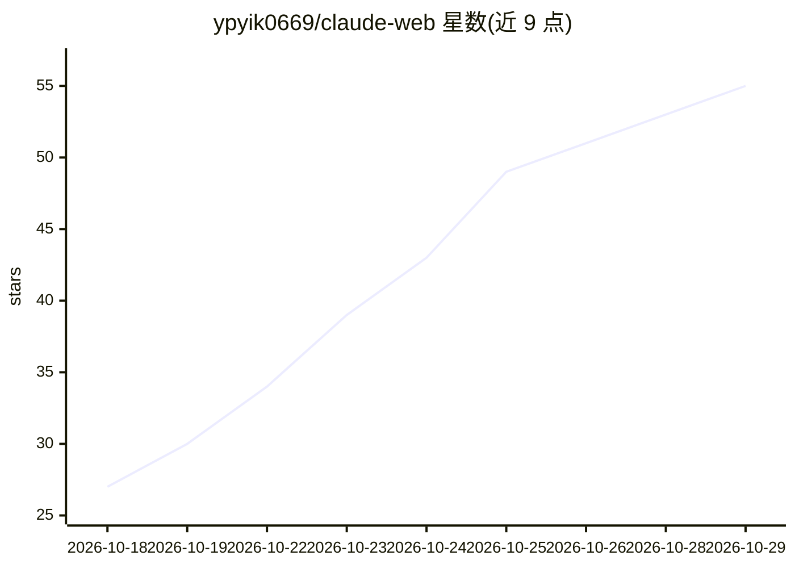

# ypyik0669/claude-web

⭐ 55 · TypeScript · MIT · 推送 2026-10-28 · [GitHub](https://github.com/ypyik0669/claude-web) · [官网](https://psycioxyxs.my) · 个人维护 · 中文 README

**Claude Code 等 CLI agent 的可视化工作台（桌面+网页）**

非官方社区开源工具，为 Claude Code CLI 提供图形界面：流式对话、每回合折叠为一行摘要、代码 diff 审查与提交、权限审批卡片、文件树/Git/编辑器、最多 6 分屏、子代理像素风'网吧'可视化页面、内置浏览器操作、定时任务与目标自动化。同一程序提供 Windows/macOS 桌面安装包与 Node.js 22.13+ 本地网页版，数据共享（~/.claude）。界面支持中英双语，可扫码用手机远程访问，同一界面还能驱动 Codex、Gemini CLI、Qwen、Kimi、OpenCode 等 CLI agent，每个会话可选不同 provider。需自带 Claude 订阅或第三方 API key，与 Anthropic 无关联。

## 筛选速览

| 维度 | 判定 | 备注 |
|---|---|---|
| AI 角色 | `ai-ecosystem` | LLM/agent 周边工具 |
| 许可风险 | `permissive` | MIT |
| 部署形态 | `desktop` | 安装包/桌面程序 |
| 模型依赖 | locked-api |  |
| 硬件要求 | — | 无带数字的原话,不猜 |
| 安装摩擦 | `low` | 无编译、无系统依赖或容器化 |
| 成熟度 | — | 结构信号不足 |

## 能力要点

- 把 Claude Code 等 CLI agent 装进图形界面，驱动 Codex/Gemini CLI/Qwen/Kimi/OpenCode
- 每回合折叠单行摘要，diff 审查面板支持暂存/回退/提交
- 子代理与工作流在像素风'网吧'页面可视化运行
- 手机扫码远程访问、SSH 隧道、Telegram/Discord/Slack/钉钉/飞书 bot

## 适用场景

- 在图形界面里使用 Claude Code 审查代码 diff 并审批权限
- 从手机远程查看和操作本机的 agent 会话
- 用同一界面切换驱动 Codex、Gemini CLI、Qwen 等多个 CLI agent
- 查看子代理、后台任务与用量/成本台账

## 场景标签

`代码审查` · 领域:编码与开发

## 证据(README 行号)

> L5: **A visual workbench for the Claude Code CLI.** It takes Claude Code out of the command line and puts it in a graphi
> L7: The same program comes in two forms: a **desktop app** (Windows / macOS) and a **web version** (run a local server a
> L34: |**Multiple agents**|Besides Claude it can drive CLI agents such as Codex, Gemini, Qwen and Kimi, with the same int

## 星数曲线

2026-10-18 27 → 2026-10-29 55（+28）

---
*卡片 v1 · prompt 1.4 · 生成 2026-10-24 · 置信度 high · 依据 README sha `f43a54523c28` · [字段定义](../../DATASET.md)*
