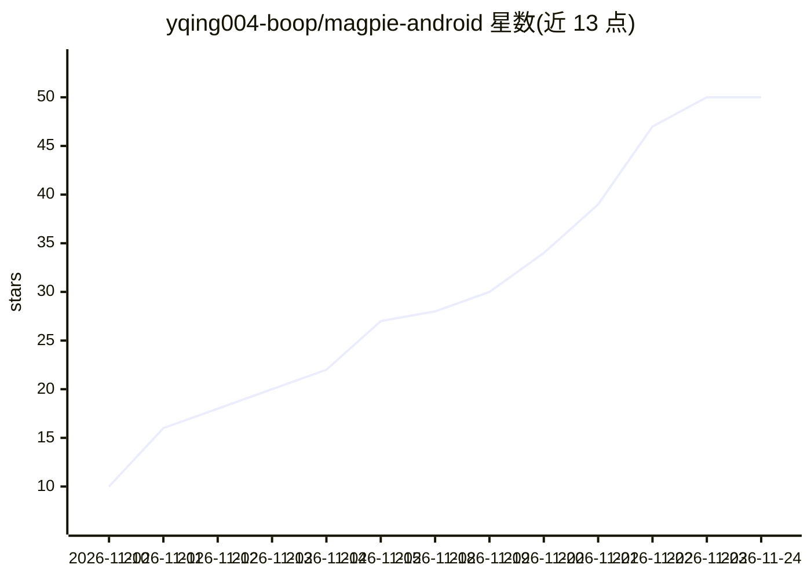

# yqing004-boop/magpie-android

⭐ 54 · Java · NOASSERTION · 推送 2026-11-23 · [GitHub](https://github.com/yqing004-boop/magpie-android) · [官网](https://www.coolapk.com/feed/74971201?s=NTU4MTYyYTQxOTEwNDdnNmFmMzNlZWF6a1665) · 个人维护 · 中文 README

**magpie 本地 AI 网关的非官方 Android 客户端**

把 magpie 本地 AI 网关装进 Android 手机：前台服务在应用私有目录运行 magpie serve，通过 http://127.0.0.1:3425/v1 提供 OpenAI/Anthropic/Gemini 等格式 API，供本机或局域网客户端调用。原生主界面（非 WebView）提供概览、用量、账号、路由四页，读取网关 HTTP 接口绘制；支持 App 内更新内核（断点续传、SHA-256 校验、回滚）、局域网共享与 Material 3 配色。仅提供 Android arm64 APK，最低 Android 7.0，无需 Root；完整网页后台仍保留用于深度功能。

## 筛选速览

| 维度 | 判定 | 备注 |
|---|---|---|
| AI 角色 | `ai-ecosystem` | LLM/agent 周边工具 |
| 许可风险 | `none` | NOASSERTION |
| 部署形态 | `None` |  |
| 模型依赖 | — | README 未给出锁定关系 |
| 硬件要求 | — | 无带数字的原话,不猜 |
| 安装摩擦 | `low` | 无编译、无系统依赖或容器化 |
| 成熟度 | — | 结构信号不足 |

## 能力要点

- 前台服务在手机上运行 magpie 网关，无需 Root/Termux
- 原生四页主界面直接读网关 HTTP 接口
- App 内更新内核：断点续传、SHA-256 校验、回滚，不需重装 APK
- 局域网共享 Base URL 与网关密钥，供同 Wi-Fi 设备调用

## 适用场景

- 在手机上管理 magpie 的供应商、账号、模型与路由
- 给手机上的 AI 客户端提供本地 OpenAI 兼容网关
- 同一 Wi-Fi 下给其他设备提供网关服务

## 场景标签

`模型网关` · 领域:Agent 开发

## 证据(README 行号)

> L21: Magpie 是一个本地 AI 网关：你可以在一个地址上管理供应商、账号、模型和路由，再让本机或局域网里的客户端按 OpenAI / Anthropic / Gemini 等 API 格式调用。
> L23: 这个仓库做的是 **Android 运行壳**：前台服务直接在手机应用私有目录运行 `magpie serve`。

## 星数曲线

2026-11-10 10 → 2026-11-24 50（+40）

---
*卡片 v1 · prompt 1.4 · 生成 2026-11-18 · 置信度 high · 依据 README sha `e2f2d22976a6` · [字段定义](../../DATASET.md)*
