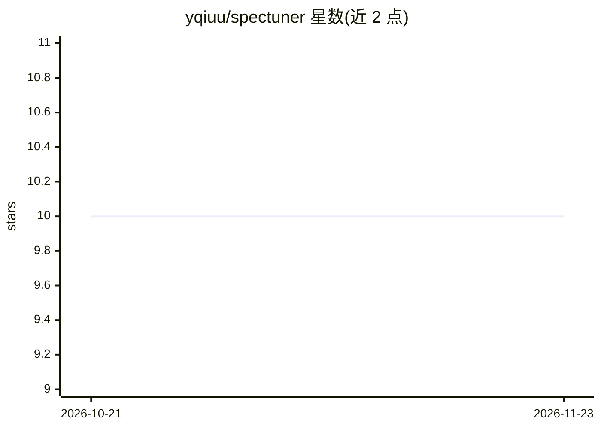

# yqiuu/spectuner

⭐ 10 · Python · BSD-3-Clause · 推送 2026-09-06 · [GitHub](https://github.com/yqiuu/spectuner) · 组织维护

**面向天文科研的星际分子谱线自动识别工具**

Spectuner 是对星际分子谱线进行自动化分析的 Python 工具，提供 AI 模块（需安装 PyTorch 并从 Hugging Face 下载神经网络权重）进行谱线识别，并以 Cologne Database for Molecular Spectroscopy（CDMS）数据库作为输入。要求 Python>=3.10，可从 PyPI 安装，另提供在线文档；作者给出 BibTeX 引用条目（发表于 ApJS）。

## 筛选速览

| 维度 | 判定 | 备注 |
|---|---|---|
| AI 角色 | `ai-native` | 本体是模型或模型工具 |
| 许可风险 | `permissive` | BSD-3-Clause |
| 部署形态 | `library` | 以包/库形式分发 |
| 模型依赖 | — | README 未给出锁定关系 |
| 硬件要求 | — | 无带数字的原话,不猜 |
| 安装摩擦 | `low` | 无编译、无系统依赖或容器化 |
| 成熟度 | — | 结构信号不足 |

## 能力要点

- 自动化的星际分子谱线识别与分析
- AI 模块基于 PyTorch，权重托管于 Hugging Face
- 以 CDMS 分子光谱数据库作为输入
- 提供 PyPI 安装与在线文档

## 适用场景

- 自动化识别射电/毫米波观测光谱中的分子谱线
- 在分子谱线研究中批量处理光谱数据

## 场景标签

`科研工具` `强化学习` · 领域:学习与行业

## 证据(README 行号)

> L4: Spectuner is a tool for automated spectral line analysis of instellar molecules.
> L15: If you want to use the AI module, you need to install
> L22: Also, please download the neural network weights file from

## 星数曲线

2026-10-21 10 → 2026-11-23 10（+0）

---
*卡片 v1 · prompt 1.4 · 生成 2026-11-19 · 置信度 high · 依据 README sha `49d841193bb0` · [字段定义](../../DATASET.md)*
