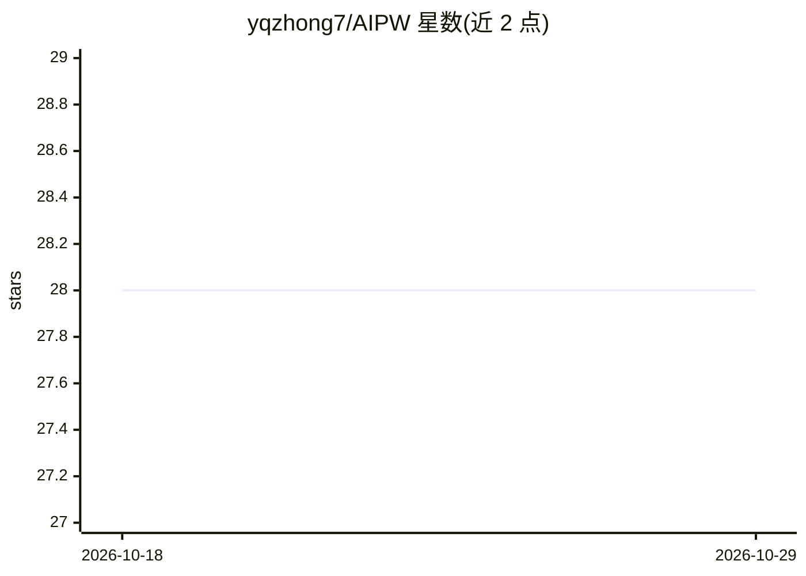

# yqzhong7/AIPW

⭐ 28 · R · GPL-3.0 · 推送 2026-04-11 · [GitHub](https://github.com/yqzhong7/AIPW) · [官网](https://yqzhong7.github.io/AIPW/) · 组织维护

**R 包：双重稳健的 AIPW 方法估计平均因果效应**

R 统计包，实现增广逆概率加权（AIPW）双重稳健估计器，用于估计二分类暴露的平均处理效应（风险差 RD、风险比 RR、比值比 OR），支持用户自定义 stacked 机器学习算法（SuperLearner 或 sl3）。提供 R6 类的链式调用接口、Repeated 类做重复交叉拟合以降低数据划分随机性、基于 future.apply 的并行计算与 progressr 进度条，并可接收 tmle/tmle3 拟合对象。新 GitHub 版本（v0.6.3.1 后）不再支持 sl3 与 tmle3，需安装 aje_version 分支；使用者需自行检验因果假设。

## 筛选速览

| 维度 | 判定 | 备注 |
|---|---|---|
| AI 角色 | `ai-native` | 本体是模型或模型工具 |
| 许可风险 | `viral` | GPL-3.0 |
| 部署形态 | `None` |  |
| 模型依赖 | — | README 未给出锁定关系 |
| 硬件要求 | — | 无带数字的原话,不猜 |
| 安装摩擦 | `low` | 无编译、无系统依赖或容器化 |
| 成熟度 | — | 结构信号不足 |

## 能力要点

- AIPW 双重稳健估计 RD/RR/OR 三种效应尺度
- Repeated 类支持重复交叉拟合与中位数汇总
- 支持 SuperLearner/sl3 堆叠机器学习与 future.apply 并行
- AIPW_tmle 类可接收 tmle/tmle3 拟合对象作为输入

## 适用场景

- 流行病学研究中估计二分类暴露的平均处理效应
- 用机器学习嵌套的半参数方法做因果推断
- 通过重复交叉拟合获得更稳定的估计结果

## 场景标签

 · 领域:统计/因果推断

## 证据(README 行号)

> L12: Augmented inverse probability weighting (AIPW) is a doubly robust
> L16: user-defined stacked machine learning algorithms
> L60: The major new feature introduced is the `Repeated` class, which allows

## 星数曲线

2026-10-18 28 → 2026-10-29 28（+0）

---
*卡片 v1 · prompt 1.4 · 生成 2026-10-26 · 置信度 high · 依据 README sha `af3d6326ee36` · [字段定义](../../DATASET.md)*
