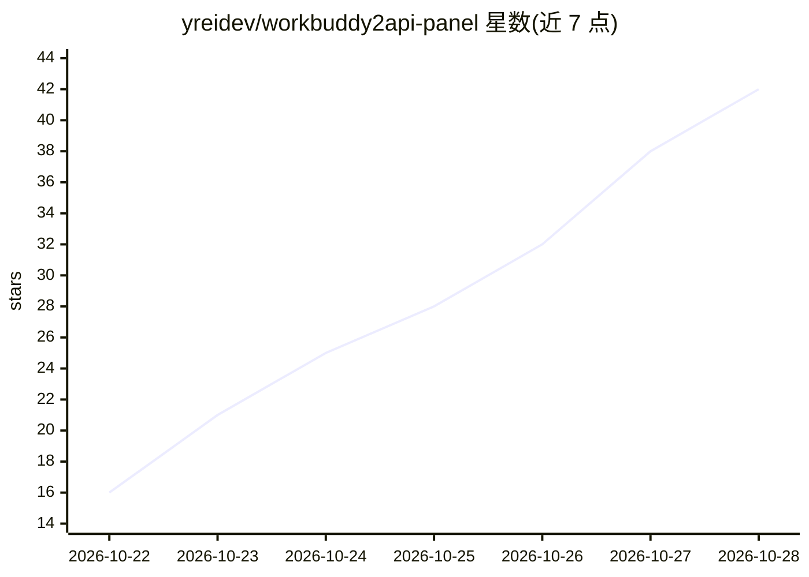

# yreidev/workbuddy2api-panel

⭐ 49 · Go · AGPL-3.0 · 推送 2026-10-28 · [GitHub](https://github.com/yreidev/workbuddy2api-panel) · 组织维护 · 中文 README

**把腾讯 WorkBuddy 账号变成 OpenAI 兼容 API 的多账号网关**

基于原版 workbuddy2api-panel 的独立维护增强版：把多个 WorkBuddy 账号（国内/国际版）接成 OpenAI 兼容 API，提供 /v1/chat/completions、/v1/messages（Claude Code）与 /v1/responses（Codex）三个入口，自动选号、限流换号、按账号加权调度。出站请求照官方桌面端 5.8.3 对齐请求头，支持主备入口与 HTTPDNS 切换，自动完成签到与成长任务，附 React 管理面板与客户端密钥体系。仅限管理自己的账号，上游为非公开接口，AGPL-3.0 授权。

## 筛选速览

| 维度 | 判定 | 备注 |
|---|---|---|
| AI 角色 | `ai-ecosystem` | LLM/agent 周边工具 |
| 许可风险 | `viral` | AGPL-3.0 |
| 部署形态 | `self-host` | docker 或自建部署 |
| 模型依赖 | — | README 未给出锁定关系 |
| 硬件要求 | — | 无带数字的原话,不猜 |
| 安装摩擦 | `low` | 无编译、无系统依赖或容器化 |
| 成熟度 | — | 结构信号不足 |

## 能力要点

- OpenAI / Claude Code / Codex 三类客户端入口（chat/completions、messages、responses）
- 多账号池：加权选号、限流换号、国内/国际双域合池负载均衡
- 每日自动签到与 17 个成长任务一键完成
- React 管理面板：账号状态、用量分析、客户端密钥、一键更新

## 适用场景

- 给自己的 WorkBuddy 账号提供 OpenAI 兼容 API 入口
- 让 Claude Code、Codex 等编程工具通过网关使用 WorkBuddy 模型
- 自动完成每日签到与成长任务保活账号

## 场景标签

`模型网关` · 领域:Agent 开发

## 证据(README 行号)

> L25: WorkBuddy2API 是一个自托管网关：把你的多个 WorkBuddy 账号接成一个 OpenAI 兼容的 API，自动挑选可用账号、处理限流与换号，并每天替你完成签到和成长任务。现有的 SDK、聊天应用、编程工具填上地址和
> L33: |**Claude Code / Codex**|原生提供 Anthropic Messages（`/v1/messages`）和 Responses（`/v1/responses`），填地址和密钥就能用；模型路由把它们的默认模型
> L180:     C["你的客户端 SDK · 聊天应用 · 编程工具"] -->|"OpenAI 兼容请求"| GW

## 星数曲线

2026-10-22 16 → 2026-10-28 42（+26）

---
*卡片 v1 · prompt 1.4 · 生成 2026-10-26 · 置信度 mid · 依据 README sha `14ee4a35031c` · [字段定义](../../DATASET.md)*
