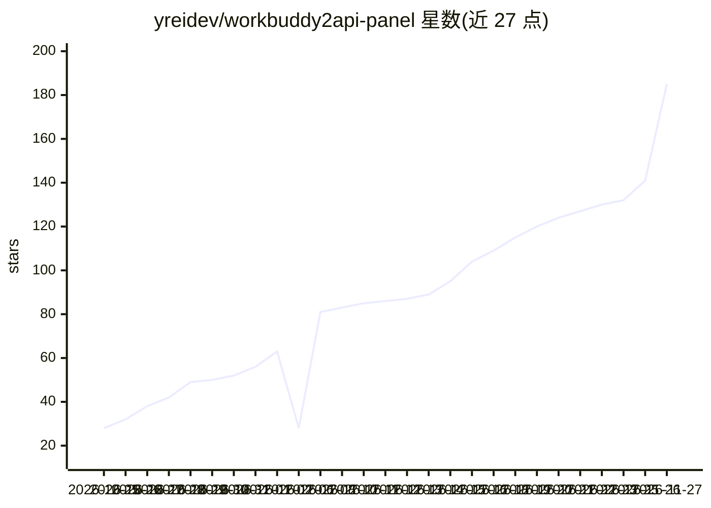

# yreidev/workbuddy2api-panel

⭐ 185 · Go · AGPL-3.0 · 推送 2026-11-26 · [GitHub](https://github.com/yreidev/workbuddy2api-panel) · 个人维护 · 中文 README

**把腾讯 WorkBuddy 账号池变成 OpenAI 兼容 API 的自托管网关**

自托管多账号 API 网关：将多个 WorkBuddy 账号接成一个 OpenAI 兼容 API，提供 /v1/chat/completions、/v1/messages（Claude Code）与 /v1/responses（Codex）端点，支持流式、工具调用、图片输入与模型路由。按成本、剩余积分、闲置时长加权选号，限流/失效自动换号，支持按号代理、国内/国际双域合池、每日签到与成长任务自动化。Go 编写，React 管理面板，Docker 或单文件部署。使用声明限个人自用管理自己的账号，v1.4.0 起为 AGPL-3.0 加署名条款。

## 筛选速览

| 维度 | 判定 | 备注 |
|---|---|---|
| AI 角色 | `ai-ecosystem` | LLM/agent 周边工具 |
| 许可风险 | `viral` | AGPL-3.0 |
| 部署形态 | `self-host` | docker 或自建部署 |
| 模型依赖 | — | README 未给出锁定关系 |
| 硬件要求 | — | 无带数字的原话,不猜 |
| 安装摩擦 | `low` | 无编译、无系统依赖或容器化 |
| 成熟度 | — | 结构信号不足 |

## 能力要点

- OpenAI、Anthropic Messages、Responses 三种端点，Claude Code / Codex 可直连
- 多账号池按成本/积分/闲置时长加权选号，限流与失效自动换号重试
- 主备入口 + HTTPDNS 自动切换，出站请求对齐官方桌面端
- 客户端密钥支持到期、用量上限、模型白名单与账号分组限制

## 适用场景

- 让 Claude Code / Codex 或 OpenAI 兼容 SDK 通过自己的 WorkBuddy 账号调用模型
- 管理多个 WorkBuddy 账号的每日签到、保活与成长任务
- 团队内部按密钥分发作额与模型权限

## 场景标签

`模型网关` · 领域:Agent 开发

## 证据(README 行号)

> L25: WorkBuddy2API 是一个自托管网关：把你的多个 WorkBuddy 账号接成一个 OpenAI 兼容的 API，自动挑选可用账号、处理限流与换号，并每天替你完成签到和成长任务。现有的 SDK、聊天应用、编程工具填上地址和
> L55:  - 提供 `/v1/chat/completions` 与 `/v1/models`，流式、非流式、工具调用、图片输入、推理档位都支持。
> L56:  - Claude Code 走 `/v1/messages`，Codex 走 `/v1/responses`，和普通对话共用同一套选号、换号与日志。

## 星数曲线

2026-10-25 28 → 2026-11-27 185（+157）

---
*卡片 v1 · prompt 1.4 · 生成 2026-11-27 · 置信度 mid · 依据 README sha `f80b8a1874e1` · [字段定义](../../DATASET.md)*
