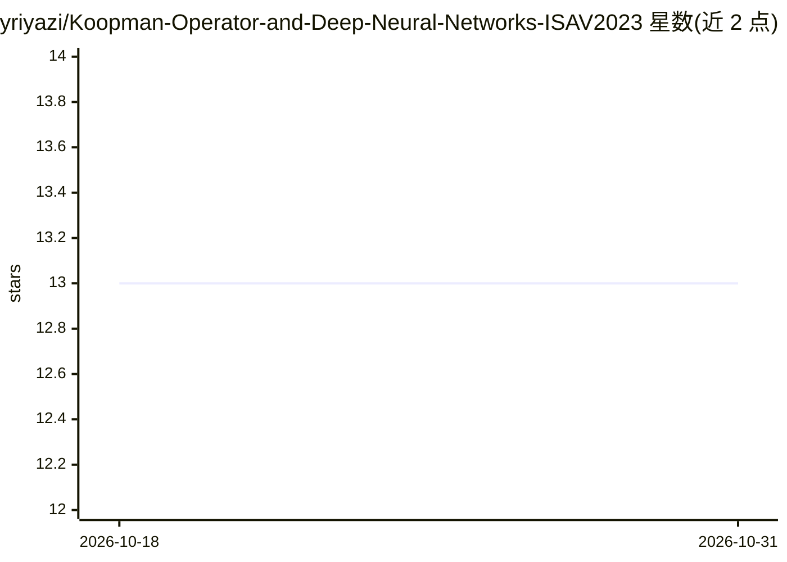

# yriyazi/Koopman-Operator-and-Deep-Neural-Networks-ISAV2023

⭐ 13 · Jupyter Notebook · NOASSERTION · 推送 2025-12-01 · [GitHub](https://github.com/yriyazi/Koopman-Operator-and-Deep-Neural-Networks-ISAV2023) · 个人维护

**Koopman 算子结合深度神经网络的 Duffing 振子预测与参数估计工具**

面向非线性动力学科研用户的代码库：用编码器-解码器神经网络学习 Koopman 嵌入，对 Duffing 振子做参数估计、长时程预测与定性分析，覆盖从周期运动到混沌的动力学区域。包含数据集生成（Runge-Kutta 求解器）、配置驱动的训练引擎（PyTorch）、自定义 Koopman 一致性损失、预训练权重与可视化（相图、Poincaré 截面、动画）。可复现 ISAV 2023 会议论文与 2024 期刊扩展实验，依赖 Python 3.8+ 与 PyTorch ≥ 1.12，需从源码运行（无独立安装包）。

## 筛选速览

| 维度 | 判定 | 备注 |
|---|---|---|
| AI 角色 | `ai-native` | 本体是模型或模型工具 |
| 许可风险 | `none` | NOASSERTION |
| 部署形态 | `None` |  |
| 模型依赖 | — | README 未给出锁定关系 |
| 硬件要求 | — | 无带数字的原话,不猜 |
| 安装摩擦 | `low` | 无编译、无系统依赖或容器化 |
| 成熟度 | — | 结构信号不足 |

## 能力要点

- 编码器-解码器架构学习 Koopman 表示并做长时程预测
- Runge-Kutta 数值求解与可控采样的轨迹数据集生成
- Poincaré 截面、2D/3D 相图与分岔扫描等可视化
- 提供预训练权重、指标日志与论文实验复现配置

## 适用场景

- 复现 ISAV 2023 与 2024 期刊的 Duffing 振子实验
- 对 Duffing 系统做参数估计与未来行为预测
- 探索不同 forcing 幅值、阻尼与噪声下的动力学行为

## 场景标签

`科研工具` · 领域:学习与行业

## 证据(README 行号)

> L3: Harnessing Koopman theory and modern deep learning, this repository delivers a full-stack toolkit for **parameter es
> L28: - **Encoder–decoder architectures** (`Model/structure.py`, `encoder.py`, `decoder.py`) tailored for Koopman represe

## 星数曲线

2026-10-18 13 → 2026-10-31 13（+0）

---
*卡片 v1 · prompt 1.4 · 生成 2026-10-31 · 置信度 high · 依据 README sha `a308111ec013` · [字段定义](../../DATASET.md)*
