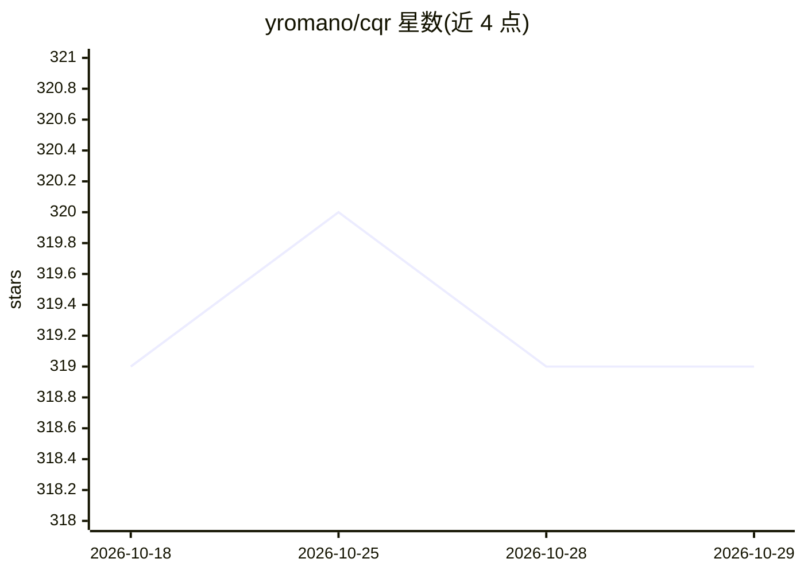

# yromano/cqr

⭐ 319 · Jupyter Notebook · NOASSERTION · 推送 2026-10-27 · [GitHub](https://github.com/yromano/cqr) · [官网](https://sites.google.com/view/cqr) · 个人维护

**Python 实现的保形化分位数回归预测区间构建库**

实现 Conformalized Quantile Regression（CQR）方法的 Python 包：结合分位数回归与保形预测，构建有限样本下分布无关的预测区间，可包裹任意分位数回归算法（随机森林、深度神经网络）。同时实现 Equalized Coverage 框架，在各受保护群体间强制相等的区间覆盖率。面向需要不确定性量化的预测建模研究场景，通过 git clone 源码运行，提供 Jupyter notebook 示例与论文实验复现代码及多个公开数据集。

## 筛选速览

| 维度 | 判定 | 备注 |
|---|---|---|
| AI 角色 | `ai-native` | 本体是模型或模型工具 |
| 许可风险 | `none` | NOASSERTION |
| 部署形态 | `None` |  |
| 模型依赖 | — | README 未给出锁定关系 |
| 硬件要求 | — | 无带数字的原话,不猜 |
| 安装摩擦 | `low` | 无编译、无系统依赖或容器化 |
| 成熟度 | — | 结构信号不足 |

## 能力要点

- CQR：有限样本、分布无关的预测区间，包裹任意分位数回归算法
- Equalized Coverage：各受保护群体间覆盖率相等的区间构建
- 提供论文 [1][2] 实验复现代码与多个公开数据集（Blog/Bike/MEPS 等）

## 适用场景

- 为回归预测结果构造带覆盖率保证的预测区间
- 检测预测在不同群体间的偏差并构建公平的区间
- 复现保形预测相关论文实验

## 场景标签

 · 领域:机器学习/统计推断

## 证据(README 行号)

> L5: This package contains a Python implementation of Conformalized quantile regression (CQR) [1] methodology for constru
> L9: CQR is a technique for constructing prediction intervals that attain valid coverage in finite samples, without makin

## 星数曲线

2026-10-18 319 → 2026-10-29 319（+0）

---
*卡片 v1 · prompt 1.4 · 生成 2026-10-21 · 置信度 high · 依据 README sha `f45d8d2c8f38` · [字段定义](../../DATASET.md)*
