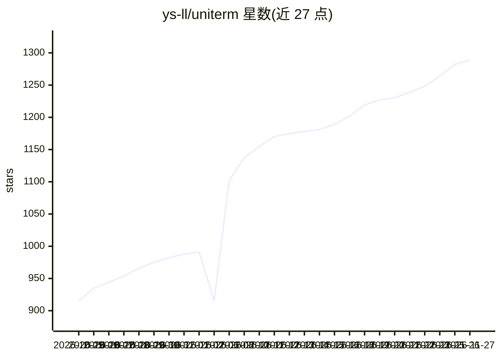

# ys-ll/uniterm

⭐ 1,289 · Go · Apache-2.0 · 推送 2026-11-26 · [GitHub](https://github.com/ys-ll/uniterm) · [官网](https://uniterm.net) · 个人维护 · 中文 README

**面向运维者的多协议终端，内置可自主执行命令的 AI Agent**

基于 Wails v3（Go + Vue 3）的跨平台桌面终端，覆盖 30+ 协议：SSH/Telnet/Mosh 终端、SFTP/SCP/SMB/WebDAV/S3 文件传输、RDP/VNC/SPICE 远程桌面、9 种数据库客户端、Kubernetes 与 Docker/Podman/containerd 容器管理及服务器监控。内置自主 AI Agent 可规划并迭代执行多轮 shell 命令，支持 Anthropic/OpenAI 兼容 API、MCP Server、技能工作流与执行权限分级。提供 Windows/macOS/Linux/Android 安装包及 Docker Web 多租户部署。

## 筛选速览

| 维度 | 判定 | 备注 |
|---|---|---|
| AI 角色 | `ai-enhanced` | 去掉 AI 部分产品仍成立 |
| 许可风险 | `permissive` | Apache-2.0 |
| 部署形态 | `desktop` | 安装包/桌面程序 |
| 模型依赖 | locked-api |  |
| 硬件要求 | — | 无带数字的原话,不猜 |
| 安装摩擦 | `low` | 无编译、无系统依赖或容器化 |
| 成熟度 | — | 结构信号不足 |

## 能力要点

- AI Agent 多轮自主执行 shell 命令，提供 Bypass 到全部确认的权限分级
- 内置 MCP Server，外部 AI 客户端可在保存的连接上执行命令与传输文件
- 30+ 协议覆盖终端、文件传输、远程桌面、数据库与容器管理
- 加密云同步支持 Git/WebDAV/SFTP/S3/SMB 五种模式

## 适用场景

- 一站式管理服务器 SSH 连接、SFTP 传文件与远程桌面
- 通过对话让 AI Agent 在终端里代为执行运维命令
- 浏览与管理 Kubernetes 集群资源和多类容器运行时
- 用自然语言查询 MySQL/PostgreSQL 等数据库并编辑数据行

## 场景标签

 · 领域:开发运维工具/终端

## 证据(README 行号)

> L29: Remote terminal, local & serial terminal, file transfer, remote desktop, database, containers, and server monitor —
> L40: Autonomous AI Agent that independently plans and executes multi-turn shell commands directly in your terminal.
> L3:  All-in-one terminal covering 30+ protocols — SSH, RDP, SFTP, databases, Kubernetes and more With a built-in AI Agen

## 星数曲线

2026-10-25 915 → 2026-11-27 1,289（+374）

---
*卡片 v1 · prompt 1.4 · 生成 2026-11-27 · 置信度 mid · 依据 README sha `64db000a3136` · [字段定义](../../DATASET.md)*
