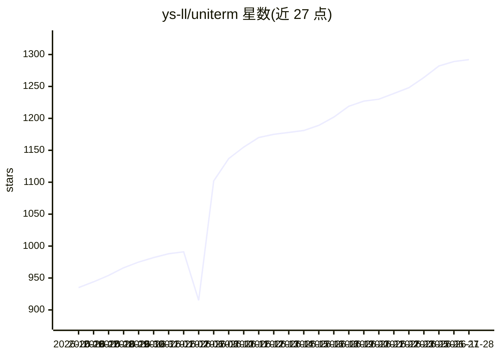

# ys-ll/uniterm

⭐ 1,292 · Go · Apache-2.0 · 推送 2026-11-27 · [GitHub](https://github.com/ys-ll/uniterm) · [官网](https://uniterm.net) · 个人维护 · 中文 README

**覆盖30+协议的终端，内置可自主执行命令的 AI Agent**

基于 Wails v3（Go + Vue 3）构建的跨平台终端工具，覆盖 SSH/Telnet/Mosh/串口等终端协议、SFTP/SCP/SMB 等 10 种文件传输、RDP/VNC/SPICE 远程桌面、9 种数据库客户端及 Kubernetes/Docker/Podman 容器管理。AI 部分：可在终端内自主规划并执行多轮 shell 命令的 Agent，四种执行权限模式可调，通过 Anthropic/OpenAI 兼容 API 接入模型；内置 MCP Server 允许外部 AI agent 在已保存连接上执行命令。Windows/macOS/Linux/Android 提供预编译包，另有 Docker 多租户部署。

## 筛选速览

| 维度 | 判定 | 备注 |
|---|---|---|
| AI 角色 | `ai-enhanced` | 去掉 AI 部分产品仍成立 |
| 许可风险 | `permissive` | Apache-2.0 |
| 部署形态 | `desktop` | 安装包/桌面程序 |
| 模型依赖 | locked-api |  |
| 硬件要求 | — | 无带数字的原话,不猜 |
| 安装摩擦 | `low` | 无编译、无系统依赖或容器化 |
| 成熟度 | — | 结构信号不足 |

## 能力要点

- 自主 AI Agent：多轮规划-执行-观察 shell 命令，四种权限模式可调
- 内置 MCP Server，供 Claude Code 等外部 agent 调用连接与文件能力
- 30+ 协议覆盖：终端、文件传输、远程桌面、数据库、容器
- 加密云同步（Git/WebDAV/SFTP/S3/SMB 五种模式）

## 适用场景

- 一个工具管理 SSH/SFTP/远程桌面/数据库/容器连接
- 让 AI Agent 在终端里代为执行多轮运维命令
- Docker 部署多租户 Web 终端供团队使用
- 导入 MobaXterm/Xshell 的既有连接迁移工具

## 场景标签

`AI 助手` · 领域:对话与助手

## 证据(README 行号)

> L29: Remote terminal, local & serial terminal, file transfer, remote desktop, database, containers, and server monitor —
> L40: Autonomous AI Agent that independently plans and executes multi-turn shell commands directly in your terminal.
> L220: This is a personal hobby project maintained in the author's spare time, with no commercialization or sponsorship p

## 星数曲线

2026-10-26 935 → 2026-11-28 1,292（+357）

---
*卡片 v1 · prompt 1.4 · 生成 2026-11-28 · 置信度 high · 依据 README sha `7b1e5c454446` · [字段定义](../../DATASET.md)*
