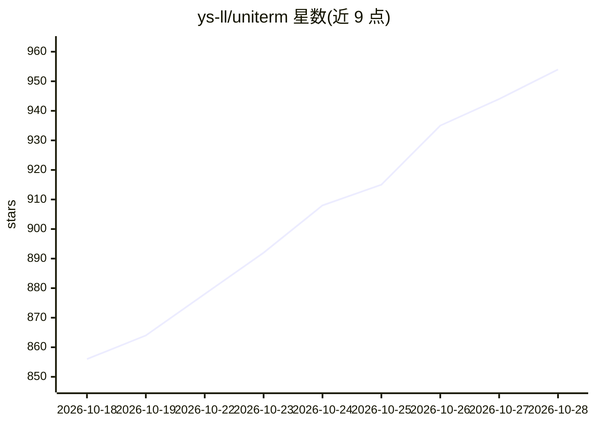

# ys-ll/uniterm

⭐ 954 · Go · Apache-2.0 · 推送 2026-10-27 · [GitHub](https://github.com/ys-ll/uniterm) · [官网](https://uniterm.net) · 个人维护 · 中文 README

**覆盖 30+ 协议的一体化终端，内置自主执行命令的 AI Agent**

基于 Go + Wails v3 + Vue 3 的跨平台桌面终端，支持 SSH/Telnet/Mosh/Serial、SFTP/SCP/S3 等文件传输、RDP/VNC 远程桌面、多种数据库客户端、Kubernetes 与容器管理及服务器监控。AI 部分为内置 Agent：通过 Anthropic/OpenAI 兼容 API 接入 Claude、GPT 等模型，规划并多轮执行 shell 命令，提供四种执行管控模式；另带 MCP server 供外部 agent 调用。提供 Windows/macOS/Linux/Android 预编译安装包与 scoop 等包管理器安装。

## 筛选速览

| 维度 | 判定 | 备注 |
|---|---|---|
| AI 角色 | `ai-enhanced` | 去掉 AI 部分产品仍成立 |
| 许可风险 | `permissive` | Apache-2.0 |
| 部署形态 | `desktop` | 安装包/桌面程序 |
| 模型依赖 | — | README 未给出锁定关系 |
| 硬件要求 | — | 无带数字的原话,不猜 |
| 安装摩擦 | `medium` | 含编译或系统依赖之一 |
| 成熟度 | — | 结构信号不足 |

## 能力要点

- AI Agent 自主规划、执行、观察并迭代多轮 shell 命令
- 支持 30+ 协议：终端/文件传输/远程桌面/数据库/容器
- 内置 MCP server，外部 AI agent 可在已保存连接上执行命令与传输文件
- Windows/macOS/Linux/Android 提供预编译安装包

## 适用场景

- 在一处终端管理 SSH、远程桌面、数据库与 Kubernetes 集群
- 让 AI Agent 在终端中自主执行多轮命令完成任务
- 通过 MCP 让 Claude Code 等外部 agent 复用已保存的连接

## 场景标签

`AI 助手` · 领域:对话与助手

## 证据(README 行号)

> L3:  All-in-one terminal covering 30+ protocols — SSH, RDP, SFTP, databases, Kubernetes and more With a built-in AI Agen
> L32: Autonomous AI Agent that independently plans and executes multi-turn shell commands directly in your terminal.
> L34: - **Autonomous AI Agent** — The AI Agent can plan, execute, observe results, and iterate across multiple rounds of 

## 星数曲线

2026-10-18 856 → 2026-10-28 954（+98）

---
*卡片 v1 · prompt 1.4 · 生成 2026-10-21 · 置信度 mid · 依据 README sha `6a0c245488da` · [字段定义](../../DATASET.md)*
