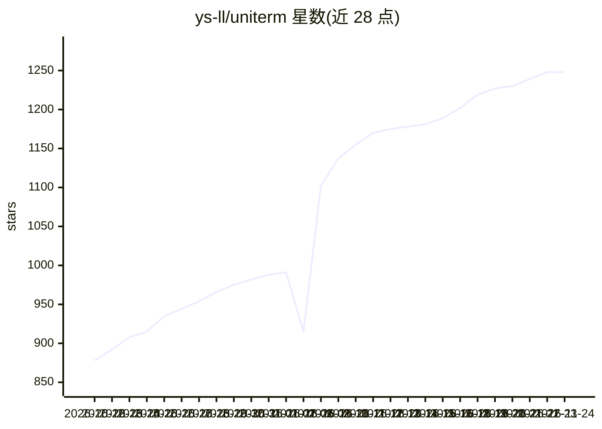

# ys-ll/uniterm

⭐ 1,248 · Go · Apache-2.0 · 推送 2026-11-21 · [GitHub](https://github.com/ys-ll/uniterm) · [官网](https://uniterm.net) · 个人维护 · 中文 README

**覆盖 30+ 协议的一体化终端，内置可自主执行命令的 AI Agent**

基于 Wails v3（Go 后端 + Vue 3 前端）的跨平台终端应用，覆盖 SSH/Telnet/Mosh/串口、SFTP/SCP/SMB/WebDAV/S3 文件传输、RDP/VNC/SPICE 远程桌面、9 类数据库客户端、Kubernetes 与 Docker/Podman/nerdctl 容器管理及服务器监控。AI 部分包括可在终端中多轮自主规划并执行 shell 命令的 Agent（四种执行管控模式）、MCP Server（供 Claude Code 等外部 agent 操作已保存连接）、技能工作流与智能补全。提供 Windows/macOS/Linux/Android 预编译包及 Docker 多租户 Web 部署，README 声明为个人业余维护项目。

## 筛选速览

| 维度 | 判定 | 备注 |
|---|---|---|
| AI 角色 | `ai-enhanced` | 去掉 AI 部分产品仍成立 |
| 许可风险 | `permissive` | Apache-2.0 |
| 部署形态 | `desktop` | 安装包/桌面程序 |
| 模型依赖 | locked-api |  |
| 硬件要求 | — | 无带数字的原话,不猜 |
| 安装摩擦 | `low` | 无编译、无系统依赖或容器化 |
| 成熟度 | — | 结构信号不足 |

## 能力要点

- AI Agent 多轮自主执行 shell 命令，四种权限管控模式（Bypass/仅危险/危险+写入/全部确认）
- 内置 MCP Server，外部 AI agent 可操作已保存连接且凭据不出应用
- 30+ 协议：SSH/RDP/SFTP/9 类数据库/K8s/Docker/Podman/nerdctl
- 五种加密云同步模式与 11 语言 UI

## 适用场景

- 通过一个终端集中管理 SSH 服务器、数据库、容器集群
- 让 AI Agent 在终端中自主完成多步运维命令
- 部署 Docker Web 版给团队提供多租户浏览器访问终端
- 从 MobaXterm/Xshell 导入既有连接配置

## 场景标签

`AI 助手` · 领域:对话与助手

## 证据(README 行号)

> L3:  All-in-one terminal covering 30+ protocols — SSH, RDP, SFTP, databases, Kubernetes and more With a built-in AI Agen
> L40: Autonomous AI Agent that independently plans and executes multi-turn shell commands directly in your terminal.
> L29: Remote terminal, local & serial terminal, file transfer, remote desktop, database, containers, and server monitor —

## 星数曲线

2026-10-22 878 → 2026-11-24 1,248（+370）

---
*卡片 v1 · prompt 1.4 · 生成 2026-11-23 · 置信度 mid · 依据 README sha `bc7e1cab1f51` · [字段定义](../../DATASET.md)*
