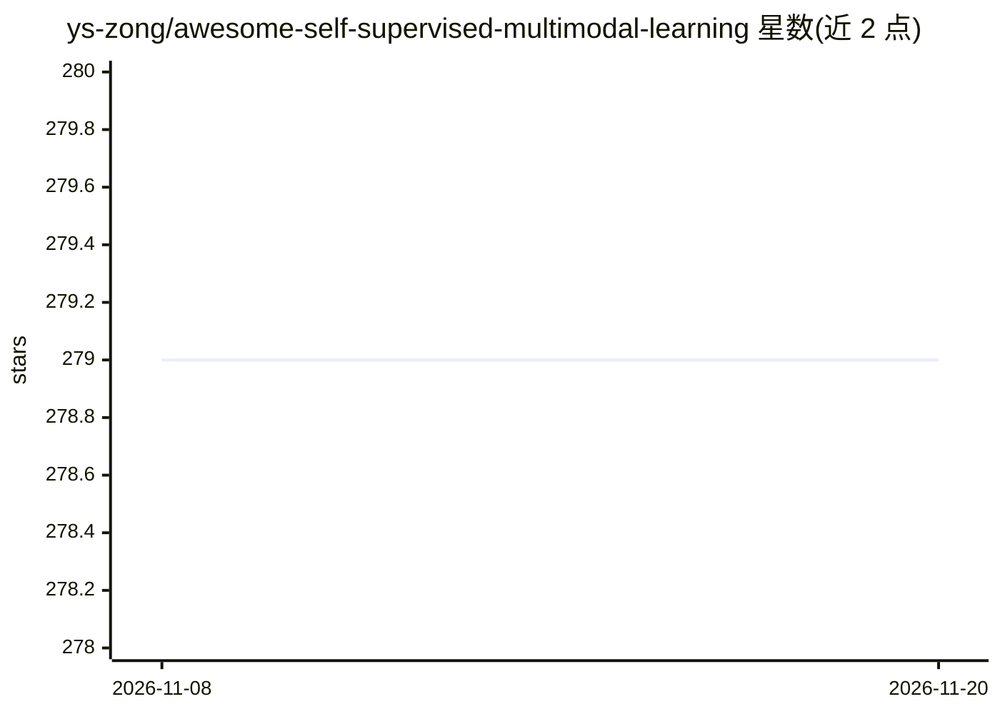

# ys-zong/awesome-self-supervised-multimodal-learning

⭐ 279 · 推送 2026-11-07 · [GitHub](https://github.com/ys-zong/awesome-self-supervised-multimodal-learning) · [官网](https://arxiv.org/abs/2304.01008) · 个人维护

**自监督多模态学习论文与资源策展清单**

配套 T-PAMI 综述论文 Self-Supervised Multimodal Learning: A Survey 的资源清单：按目标（实例判别、聚类、掩码预测）等类别组织自监督多模态学习论文条目，多数条目附论文链接，部分附官方代码仓库；另收录相关综述论文并给出分类学概述（无标签表征学习、多模态融合、非对齐数据学习三大挑战）。面向多模态表示学习方向的研究人员，用于文献检索与代码查找。清单本身不含可运行代码。

## 筛选速览

| 维度 | 判定 | 备注 |
|---|---|---|
| AI 角色 | `ai-knowledge` | 知识聚合/清单类 |
| 许可风险 | `none` | — |
| 部署形态 | `None` |  |
| 模型依赖 | — | README 未给出锁定关系 |
| 硬件要求 | — | 无带数字的原话,不猜 |
| 安装摩擦 | `low` | 无编译、无系统依赖或容器化 |
| 成熟度 | — | 结构信号不足 |

## 能力要点

- 按学习目标（实例判别/聚类/掩码预测等）分类组织论文条目
- 多数条目附带论文链接，部分附带官方代码仓库
- 配套 T-PAMI 综述论文并附 BibTeX 引用

## 适用场景

- 查找自监督多模态学习方向的论文与对应代码
- 按学习目标类别浏览该领域方法脉络
- 为相关研究定位可复现的官方实现

## 场景标签

`精选清单` `科研工具` · 领域:学习与行业

## 证据(README 行号)

> L4: A curated list of awesome self-supervised multimodal learning resources. Check our survey paper for details!
> L16: **Taxonomy**: Multimodal learning, which aims to understand and analyze information from multiple modalities, has a

## 星数曲线

2026-11-08 279 → 2026-11-20 279（+0）

---
*卡片 v1 · prompt 1.4 · 生成 2026-11-18 · 置信度 high · 依据 README sha `76fa72c94495` · [字段定义](../../DATASET.md)*
