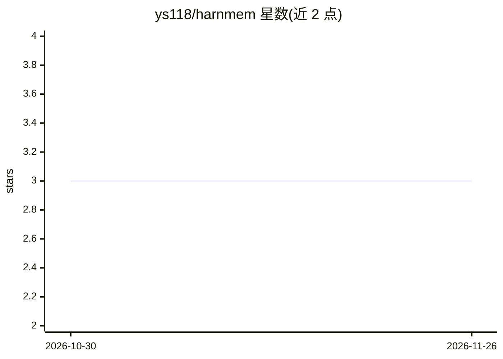

# ys118/harnmem

⭐ 3 · TypeScript · MIT · 推送 2026-11-10 · [GitHub](https://github.com/ys118/harnmem) · 个人维护

**为编码 agent 提供跨工具共享的本地文件式记忆库**

HarnMem 将编码 agent 的记忆以 Markdown 文件（含 YAML frontmatter）存储在 ~/.harnmem/ 下，用本地确定性引擎检索，并向各 harness 会话注入字节稳定的索引块。提供 @harnmem/core 引擎与 CLI，以及 pi、DeepSeek Harness、Claude Code、Codex、opencode、Grok、Cursor、Hermes、omp 等九个适配器，各适配器读写同一存储。检索不依赖嵌入模型，采用 CJK 分词、BM25F、实体/标签/时间过滤与可解释评分；支持 ADD-only 双时态写入、去重合并、归档回收与审计日志。要求 Node.js 22.15+。

## 筛选速览

| 维度 | 判定 | 备注 |
|---|---|---|
| AI 角色 | `ai-ecosystem` | LLM/agent 周边工具 |
| 许可风险 | `permissive` | MIT |
| 部署形态 | `library` | 以包/库形式分发 |
| 模型依赖 | — | README 未给出锁定关系 |
| 硬件要求 | — | 无带数字的原话,不猜 |
| 安装摩擦 | `low` | 无编译、无系统依赖或容器化 |
| 成熟度 | — | 结构信号不足 |

## 能力要点

- 记忆以纯 Markdown 文件存储，跨 harness 共享同一存储
- 零运行时依赖，仅用 Node.js 内置模块，无服务/向量库/嵌入模型
- 无嵌入检索：CJK bigram、BM25F、链接扩散与可解释评分
- ADD-only 双时态写入、trash/restore 与 append-only 审计日志

## 适用场景

- 多个编码 agent（pi、Claude Code、Codex 等）之间共享项目记忆
- 不依赖服务与向量数据库的本地 agent 记忆方案
- 将 DSH、pi、ZCode、Claude Code 等既有记忆迁移到统一存储

## 场景标签

`Agent 记忆` · 领域:Agent 开发

## 证据(README 行号)

> L17: HarnMem is a portable memory system for coding agents. It stores memories as
> L21: a memory written in one harness is available in another — no server, no vector
> L46: - **Status:** v0.7.3 — the engine, the CLI/migration tooling and all eight

## 星数曲线

2026-10-30 3 → 2026-11-26 3（+0）

---
*卡片 v1 · prompt 1.4 · 生成 2026-11-21 · 置信度 high · 依据 README sha `c066fb4a5db5` · [字段定义](../../DATASET.md)*
