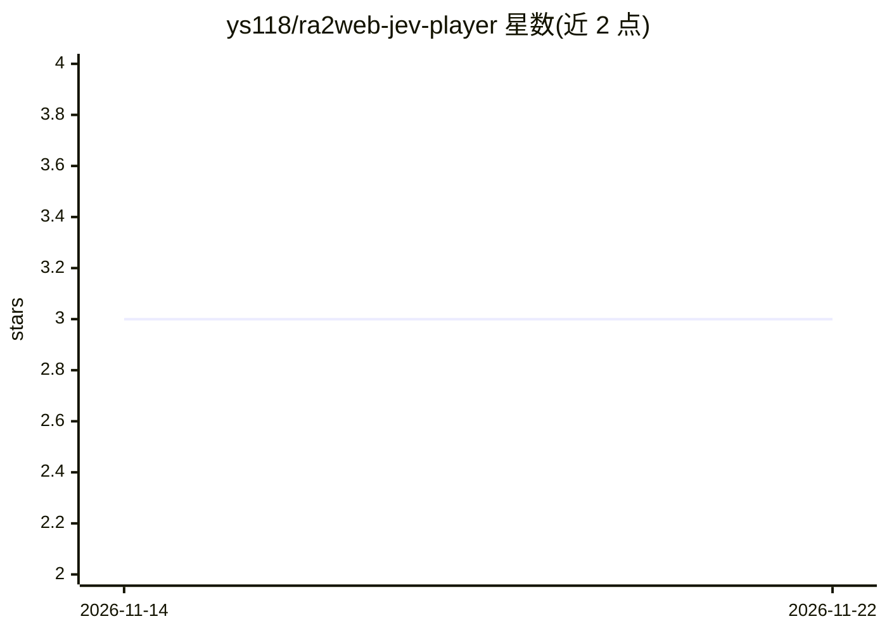

# ys118/ra2web-jev-player

⭐ 3 · Python · MIT · 推送 2026-11-03 · [GitHub](https://github.com/ys118/ra2web-jev-player) · 个人维护 · 中文 README

**用语义决策模型自动打网页版红警2遭遇战的机器人**

面向浏览器游戏 Chrono Divide（网页版红色警戒2）的自包含单人对战机器人：一条命令从冷启动浏览器到产出对局报告。通过游戏官方玩家控制台 API 注入页内客户端，无头浏览器驱动；决策分两层——确定性代码负责机制层（建造顺序、经济底线、侦察路线、撤退阈值），语义模型只做立场、威胁评估、单位配比、进攻时机等判断。每局写入结构化记录并自审，白名单限幅调参供下局加载；每局生成 state→questions→answers 训练数据供后续 SFT/RL。仅限单人对战，不使用记忆编辑或隐状态读取。

## 筛选速览

| 维度 | 判定 | 备注 |
|---|---|---|
| AI 角色 | `ai-native` | 本体是模型或模型工具 |
| 许可风险 | `permissive` | MIT |
| 部署形态 | `None` |  |
| 模型依赖 | — | README 未给出锁定关系 |
| 硬件要求 | — | 无带数字的原话,不猜 |
| 安装摩擦 | `low` | 无编译、无系统依赖或容器化 |
| 成熟度 | — | 结构信号不足 |

## 能力要点

- 全程走游戏官方公开 API（window.werhd），不改游戏、不桥接
- 两层决策：确定性机制层 + 语义模型决策层，带置信度门控
- 学习闭环：赛后审计→语义复盘→白名单限幅调参（doctrine.json）
- 每局产出 decisions.jsonl/events.jsonl 等训练数据，append-only

## 适用场景

- 让机器人代替自己打网页版红警2单人的遭遇战
- 研究游戏 AI 的语义决策与参数自调优闭环
- 积累对局数据用于后续 SFT/强化学习实验

## 场景标签

`浏览器自动化` · 领域:效率与自动化

## 证据(README 行号)

> L19: **official** player console API, plays the match with a mix of deterministic
> L37: - **Two-layer decisions.** Deterministic code owns mechanics (build order,
> L41: - **A real learning loop.** Audit → deterministic analysis → semantic review →

## 星数曲线

2026-11-14 3 → 2026-11-22 3（+0）

---
*卡片 v1 · prompt 1.4 · 生成 2026-11-21 · 置信度 high · 依据 README sha `8759f080cb8b` · [字段定义](../../DATASET.md)*
