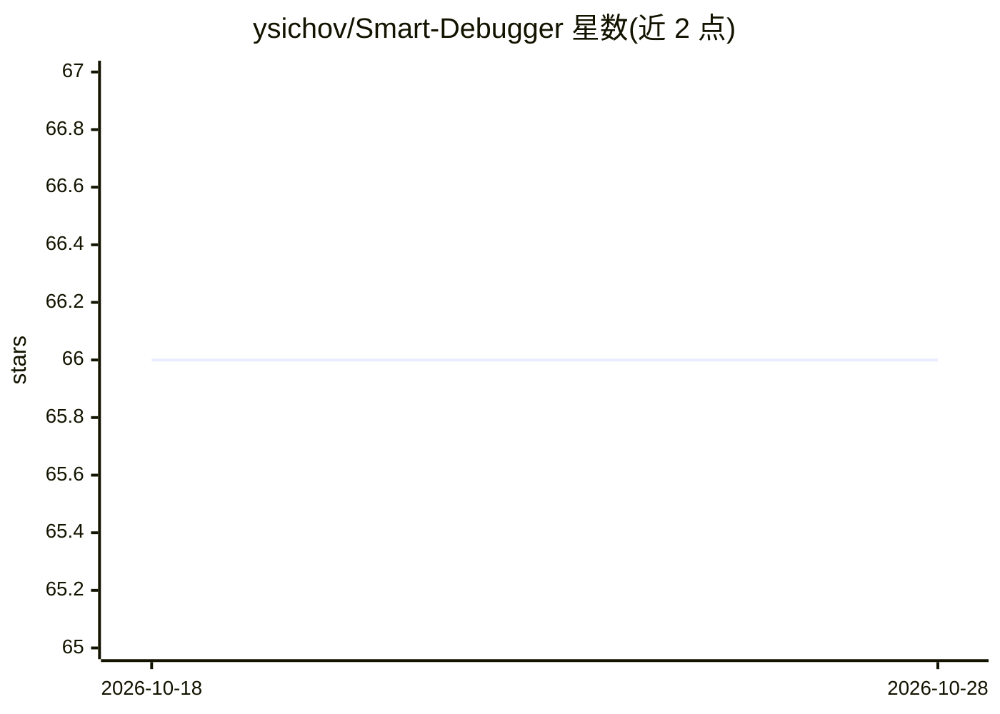

# ysichov/Smart-Debugger

⭐ 66 · ABAP · MIT · 推送 2026-08-18 · [GitHub](https://github.com/ysichov/Smart-Debugger) · 个人维护

**面向 SAP ABAP 开发者的带时间回溯与 AI 助手的调试器脚本**

运行于 SAP GUI New Debugger 的调试器脚本（Project ARIADNA，beta 0.9.600）：以多窗口工作区一次性展示当前程序全部变量、结构、内表与对象实例，记录每一步与每次变量变化，支持向后单步与回到上一个断点/观察点；内表可开多个 ALV 窗口，提供 Mermaid 调用图、控制结构图与执行覆盖高亮。可选 AI 面板由独立项目 ABAP-AI-Code 提供 LLM 客户端，无配置时不显示；standalone 单文件版不含 AI。要求 ABAP 7.40+ 与标准调试授权，可选 abapGit 安装。

## 筛选速览

| 维度 | 判定 | 备注 |
|---|---|---|
| AI 角色 | `ai-enhanced` | 去掉 AI 部分产品仍成立 |
| 许可风险 | `permissive` | MIT |
| 部署形态 | `None` |  |
| 模型依赖 | — | README 未给出锁定关系 |
| 硬件要求 | — | 无带数字的原话,不猜 |
| 安装摩擦 | `low` | 无编译、无系统依赖或容器化 |
| 成熟度 | `idea` | |

## 能力要点

- 记录每步与每次变量变化，支持向后调试（时间机器）
- 一次展示全部局部/全局/SY/CLASS-DATA/LDB 变量的层级树
- 内表各开独立 ALV 窗口，带 Select-Options 过滤与覆盖高亮
- 可选 AI 面板：LLM 分析当前步/栈/变量并提议 bug 原因

## 适用场景

- ABAP 开发中排查深层结构与多张内表的数据问题
- 追溯某个变量值的历史来源，避免反复重启事务重跑
- 调试会话中查看调用流图与已执行代码覆盖

## 场景标签

 · 领域:软件开发/调试工具

## 证据(README 行号)

> L8: Smart Debugger is a **debugger script** for the SAP GUI New Debugger. It opens its own multi-window
> L236: The `AI` button opens a panel where an LLM analyses the current step, the stack, the variables and the
> L242: - Without that configuration the `AI` button is **not displayed** at all.

## 星数曲线

2026-10-18 66 → 2026-10-28 66（+0）

---
*卡片 v1 · prompt 1.4 · 生成 2026-10-24 · 置信度 high · 依据 README sha `b471f1146fa9` · [字段定义](../../DATASET.md)*
