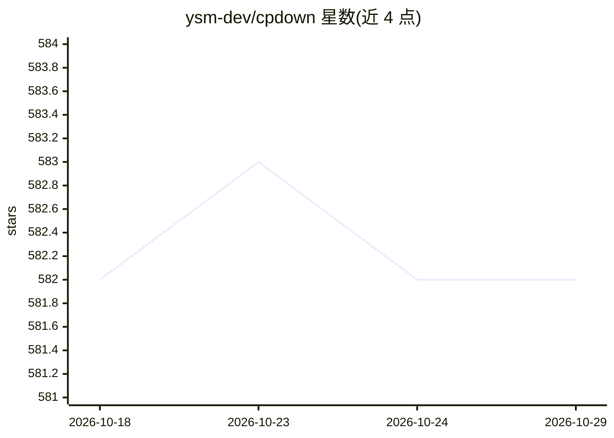

# ysm-dev/cpdown

⭐ 582 · TypeScript · MIT · 推送 2026-10-26 · [GitHub](https://github.com/ysm-dev/cpdown) · [官网](https://chromewebstore.google.com/detail/cpdown/knnaflplggjdedobhbidojmmnocfbopf) · 个人维护

**浏览器扩展：一键复制网页内容/YouTube 字幕为干净 Markdown**

基于 WXT 与 React 构建的浏览器扩展，面向需要把网页正文或 YouTube 字幕转为 Markdown 的用户。通过 Defuddle 或 Mozilla Readability 提取正文，去除脚本、样式、iframe 等元素，经 Turndown 转为 Markdown 并复制到剪贴板，支持键盘快捷键与多种输出选项；为 LLM 场景显示复制内容的 token 计数（tiktoken）。通过 Chrome Web Store 与 Firefox Add-ons 安装，也可用 bun 构建后以开发者模式加载。

## 筛选速览

| 维度 | 判定 | 备注 |
|---|---|---|
| AI 角色 | `ai-enhanced` | 去掉 AI 部分产品仍成立 |
| 许可风险 | `permissive` | MIT |
| 部署形态 | `None` |  |
| 模型依赖 | — | README 未给出锁定关系 |
| 硬件要求 | — | 无带数字的原话,不猜 |
| 安装摩擦 | `low` | 无编译、无系统依赖或容器化 |
| 成熟度 | — | 结构信号不足 |

## 能力要点

- 一键复制任意网页正文为 Markdown
- 一键复制 YouTube 字幕为 Markdown
- Defuddle / Mozilla Readability 双解析引擎可切换
- 显示复制内容的 token 计数，供 LLM 使用

## 适用场景

- 把网页文章整理成 Markdown 粘贴到笔记或文档
- 复制 YouTube 字幕供阅读或翻译
- 将网页内容连同 token 数喂给 LLM

## 场景标签

`网页抓取` · 领域:效率与自动化

## 证据(README 行号)

> L8: cpdown is a browser extension that allows you to copy the content of any webpage as clean, formatted markdown. If yo
> L20: - 🔢 Shows token count for the copied content (for LLM)

## 星数曲线

2026-10-18 582 → 2026-10-29 582（+0）

---
*卡片 v1 · prompt 1.4 · 生成 2026-10-22 · 置信度 high · 依据 README sha `8cc6ddf5166d` · [字段定义](../../DATASET.md)*
