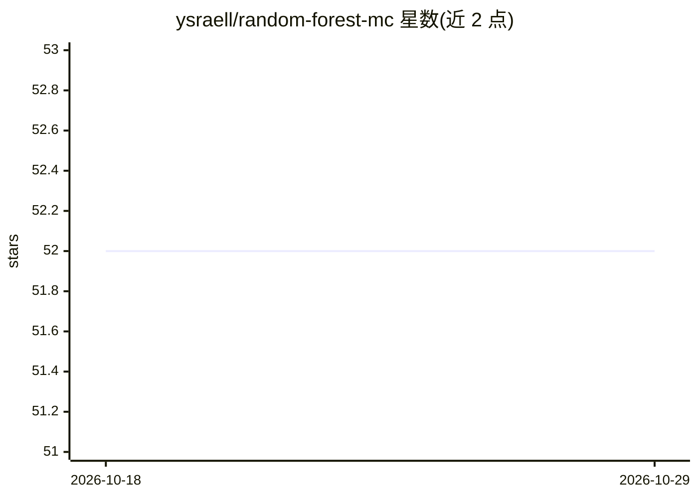

# ysraell/random-forest-mc

⭐ 52 · Python · MIT · 推送 2026-09-27 · [GitHub](https://github.com/ysraell/random-forest-mc) · 个人维护

**蒙特卡洛动态树选择的多分类随机森林 Python 库**

基于随机森林方法做多分类的 Python 机器学习库：通过蒙特卡洛模拟间接优化进行树的动态选择，支持类别不平衡与缺失数据（训练和预测阶段）下的训练，支持并行训练与模型合并（简单或优化合并，新旧森林可混合）。v1.5.0 起提供双引擎：C++17/nanobind 引擎与纯 Python/NumPy 引擎，两者 API 与序列化完全互通，模型可跨引擎加载。另提供缺失值预测（predictMissingValues）与特征计数/重要性功能，通过 pip 安装。

## 筛选速览

| 维度 | 判定 | 备注 |
|---|---|---|
| AI 角色 | `ai-native` | 本体是模型或模型工具 |
| 许可风险 | `permissive` | MIT |
| 部署形态 | `library` | 以包/库形式分发 |
| 模型依赖 | — | README 未给出锁定关系 |
| 硬件要求 | — | 无带数字的原话,不猜 |
| 安装摩擦 | `low` | 无编译、无系统依赖或容器化 |
| 成熟度 | — | 结构信号不足 |

## 能力要点

- 蒙特卡洛模拟间接优化进行树的动态选择
- 支持类别不平衡与缺失数据（训练与预测）
- v1.5.0 起双引擎：C++17 与纯 Python，模型序列化跨引擎互通
- 支持多个已训练森林的简单或优化合并

## 适用场景

- 我在不平衡数据集上做多分类（如流失预测）
- 我的数据存在缺失值，仍需训练与预测
- 我希望合并新旧模型以减少新数据偏差

## 场景标签

 · 领域:机器学习/数据科学

## 证据(README 行号)

> L6: This project is about use Random Forest approach for *multiclass classification* using a dynamic tree selection Mont
> L10: This version of Random Forest makes the selection of trees based on indirect optimization via Monte Carlo simulatio

## 星数曲线

2026-10-18 52 → 2026-10-29 52（+0）

---
*卡片 v1 · prompt 1.4 · 生成 2026-10-24 · 置信度 high · 依据 README sha `88a1c908baaa` · [字段定义](../../DATASET.md)*
