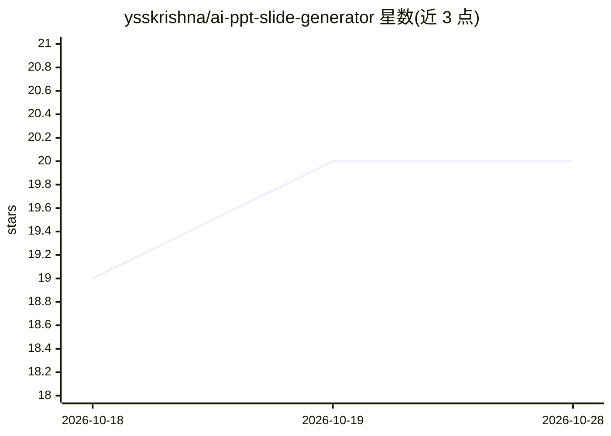

# ysskrishna/ai-ppt-slide-generator

⭐ 20 · Python · MIT · 推送 2025-12-27 · [GitHub](https://github.com/ysskrishna/ai-ppt-slide-generator) · 个人维护

**用 Google Gemini 生成 PPTX 演示文稿的 FastAPI 后端服务**

基于 FastAPI 的后端 API 服务，通过 Google Gemini 根据主题和幻灯片数量自动生成幻灯片内容，也支持用户提供自定义内容；用 python-pptx 生成可下载的 .pptx 文件，并支持配置字体、字色与背景色。演示文稿与配置数据存储于 PostgreSQL。提供 Docker Compose 部署方式，也可本地 pip 安装依赖后运行 main.py；运行需 Python 3.12+ 与 Gemini API key。面向需要程序化生成演示文稿的开发者。

## 筛选速览

| 维度 | 判定 | 备注 |
|---|---|---|
| AI 角色 | `ai-native` | 本体是模型或模型工具 |
| 许可风险 | `permissive` | MIT |
| 部署形态 | `self-host` | docker 或自建部署 |
| 模型依赖 | — | README 未给出锁定关系 |
| 硬件要求 | — | 无带数字的原话,不猜 |
| 安装摩擦 | `low` | 无编译、无系统依赖或容器化 |
| 成熟度 | — | 结构信号不足 |

## 能力要点

- 由主题与幻灯片数经 Gemini 生成幻灯片内容
- 支持自定义内容以及字体、字色、背景色配置
- REST API 创建/配置/查询/下载 .pptx 文件
- Docker Compose 一键部署（API 端口 8085）

## 适用场景

- 在我的应用里接入自动生成 PPT 的后端服务
- 按自定义内容与样式批量生成演示文稿
- 程序化下载生成的 .pptx 文件

## 场景标签

`AI 写作` · 领域:内容生成

## 证据(README 行号)

> L11: PPT Generator is a backend API service that generates PowerPoint presentations (PPTX) using AI (Google Gemini) or c
> L16: - **AI-powered slide generation**: Generate slide content automatically from a topic and slide count using Google G
> L24: - **AI Integration**: Google Gemini for content generation

## 星数曲线

2026-10-18 19 → 2026-10-28 20（+1）

---
*卡片 v1 · prompt 1.4 · 生成 2026-10-28 · 置信度 mid · 依据 README sha `33bfe006eee7` · [字段定义](../../DATASET.md)*
