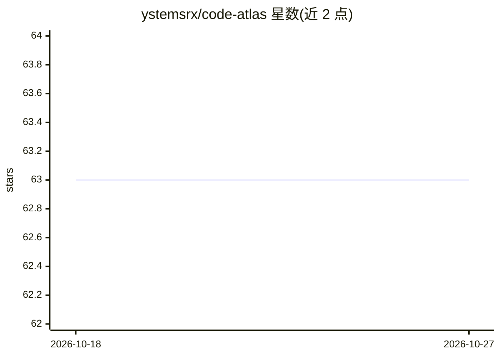

# ystemsrx/code-atlas

⭐ 63 · C++ · MIT · 推送 2025-11-13 · [GitHub](https://github.com/ystemsrx/code-atlas) · [官网](https://huggingface.co/ystemsrx/Qwen2.5-Interpreter) · 个人维护 · 中文 README

**本地运行脚本与代码的 C++ 智能体应用，Open Interpreter 的 C++ 实现**

受 Open Interpreter 启发、用 C++ 实现的跨平台本地智能体应用：通过自然语言驱动，在 Windows/Linux/macOS 上本地执行 Python、PowerShell/Batch、Bash 脚本，并可跨多轮保留 Python 环境状态。LLM 侧支持完全离线运行（兼容 llama.cpp 本地推理服务），也可选接入 OpenAI API 兼容的远程服务。提供流式 CLI 与 JSON 配置系统；可下载预编译二进制、从源码构建或使用 Docker。执行不可信模型或提示词时存在本地脚本执行风险，README 已给出安全提示。

## 筛选速览

| 维度 | 判定 | 备注 |
|---|---|---|
| AI 角色 | `ai-native` | 本体是模型或模型工具 |
| 许可风险 | `permissive` | MIT |
| 部署形态 | `self-host` | docker 或自建部署 |
| 模型依赖 | local-ok | 支持本地模型 |
| 硬件要求 | — | 无带数字的原话,不猜 |
| 安装摩擦 | `low` | 无编译、无系统依赖或容器化 |
| 成熟度 | — | 结构信号不足 |

## 能力要点

- 自然语言驱动本地执行 Python / PowerShell / Batch / Bash 脚本
- 兼容 llama.cpp 本地推理，可完全离线运行
- 跨多轮保留 Python 会话状态（IPython 式有状态执行）
- 支持预编译二进制、源码构建与 Docker 三种部署方式

## 适用场景

- 在本地用自然语言让 AI 编写并执行脚本完成计算、文件管理等任务
- 在无外网或注重隐私的环境下运行 LLM 代码助手
- 跨平台在 Windows/Linux/macOS 上复用同一命令行智能体

## 场景标签

`编码 Agent` · 领域:编码与开发

## 证据(README 行号)

> L5: **Code Atlas** is a powerful cross-platform local intelligent agent application inspired by Open Interpreter. Implem
> L13: * 🚀 **Built-in LLM Support**: Compatible with `llama.cpp` for local model inference

## 星数曲线

2026-10-18 63 → 2026-10-27 63（+0）

---
*卡片 v1 · prompt 1.4 · 生成 2026-10-24 · 置信度 mid · 依据 README sha `15693fac466b` · [字段定义](../../DATASET.md)*
