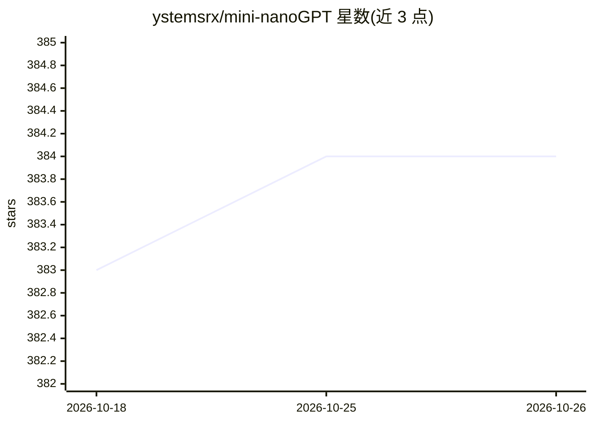

# ystemsrx/mini-nanoGPT

⭐ 384 · Python · MIT · 推送 2026-10-12 · [GitHub](https://github.com/ystemsrx/mini-nanoGPT) · [官网](https://b23.tv/Ia9mqPS) · 个人维护 · 中文 README

**面向初学者的可视化 GPT 训练平台：一键预训练与 SFT**

基于 karpathy/nanoGPT 升级的图形化训练工具，以 Gradio Web 界面替代命令行，覆盖数据处理、预训练、文本生成、SFT 微调与模型对比的完整流程。支持字符级或自定义分词器（如 Qwen），支持多进程加速与分布式训练，提供模型数据库与断点续训。提供 Docker 一键部署与本地 venv 安装两种方式，容器自动检测 CPU/GPU 环境，启动后经 localhost:7860 访问，界面支持中英双语。

## 筛选速览

| 维度 | 判定 | 备注 |
|---|---|---|
| AI 角色 | `ai-ecosystem` | LLM/agent 周边工具 |
| 许可风险 | `permissive` | MIT |
| 部署形态 | `None` |  |
| 模型依赖 | — | README 未给出锁定关系 |
| 硬件要求 | — | 无带数字的原话,不猜 |
| 安装摩擦 | `low` | 无编译、无系统依赖或容器化 |
| 成熟度 | — | 结构信号不足 |

## 能力要点

- 图形界面完成数据处理、训练、推理、SFT 与模型对比全流程
- 支持字符级或自定义分词器（Qwen 等）
- Alpaca 格式 SFT 微调与对话式推理
- Docker 一键部署，容器自动检测 CPU/GPU 环境

## 适用场景

- 零基础在图形界面中训练自己的 GPT 模型
- 用 Alpaca 数据集对预训练模型做对话微调
- 并排对比两个模型的生成效果

## 场景标签

`微调` `模型训练` · 领域:训练与推理

## 证据(README 行号)

> L19:  A visualized training platform upgraded from karpathy/nanoGPT. Make GPT training fun and approachable!
> L23: Mini-NanoGPT is a tool that helps you get started with training GPT models effortlessly. Whether you're:

## 星数曲线

2026-10-18 383 → 2026-10-26 384（+1）

---
*卡片 v1 · prompt 1.4 · 生成 2026-10-21 · 置信度 high · 依据 README sha `70ae44b2bbc1` · [字段定义](../../DATASET.md)*
