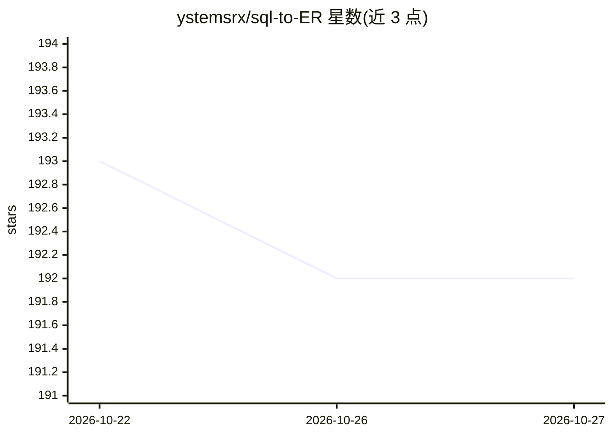

# ystemsrx/sql-to-ER

⭐ 192 · JavaScript · AGPL-3.0 · 推送 2026-10-21 · [GitHub](https://github.com/ystemsrx/sql-to-ER) · [官网](https://ystemsrx.github.io/sql-to-ER/) · 个人维护 · 中文 README

**在线 SQL/DBML 转 Chen 模型 ER 图的纯前端工具**

基于 TypeScript/React/Vite/G6 的纯前端网页工具，读取 SQL CREATE TABLE 语句或 DBML 代码，生成 Chen 模型 ER 图；支持拖拽节点、双击编辑、智能布局整理、画布缩放旋转与生成历史快照（IndexedDB 本地存储，6 小时会话恢复）。无需登录与付费，提供在线版本，也可 git clone 后用 pnpm 本地运行（需 Vite 编译）。另可通过 npx skills add 安装为 Agent Skill。与标准 Chen 模型在关系命名、实体属性命名上有简化，作者声明为免费替代品，逻辑模型需求推荐 dbdiagram.io。

## 筛选速览

| 维度 | 判定 | 备注 |
|---|---|---|
| AI 角色 | `ai-ecosystem` | LLM/agent 周边工具 |
| 许可风险 | `viral` | AGPL-3.0 |
| 部署形态 | `library` | 以包/库形式分发 |
| 模型依赖 | — | README 未给出锁定关系 |
| 硬件要求 | — | 无带数字的原话,不猜 |
| 安装摩擦 | `low` | 无编译、无系统依赖或容器化 |
| 成熟度 | — | 结构信号不足 |

## 能力要点

- SQL CREATE TABLE 与 DBML 双格式输入，生成 Chen 模型 ER 图
- 拖拽节点、双击编辑、智能调整与快速布局
- 生成历史快照持久化于浏览器 IndexedDB，6 小时内自动恢复会话
- 可通过 npx skills add 安装为 Agent Skill

## 适用场景

- 学习数据库课程时把建表语句转成 ER 图
- 快速为现有 SQL/DBML 生成可分享的 ER 图，无需登录注册
- 在 agent 中以 Skill 形式调用 SQL 转 ER 图能力

## 场景标签

 · 领域:数据库/开发工具

## 证据(README 行号)

> L21: ## 🤖 作为 Skill 安装
> L31: 一个基于网页的**纯前端**工具，用于从 SQL `CREATE TABLE` 语句和 DBML 代码生成 **Chen 模型 ER 图**。无需登录，无需付费，完全免费开源。

## 星数曲线

2026-10-22 193 → 2026-10-27 192（-1）

---
*卡片 v1 · prompt 1.4 · 生成 2026-10-22 · 置信度 mid · 依据 README sha `c25ef6b6e6db` · [字段定义](../../DATASET.md)*
