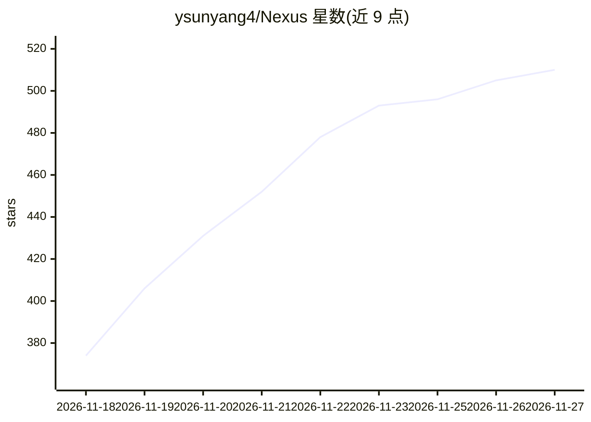

# ysunyang4/Nexus

⭐ 510 · TypeScript · AGPL-3.0 · 推送 2026-11-26 · [GitHub](https://github.com/ysunyang4/Nexus) · [官网](https://github.com/ysunyang4/Nexus) · 个人维护 · 中文 README

**把网页 AI 助手安全接入本地文件/终端/Git 的 MCP 控制面**

Nexus 是面向 ChatGPT、DeepSeek 等网页 AI 助手的本地 MCP 控制面：通过 Streamable HTTP 安全隧道将远程 LLM 接到本地工作站，提供 332 个规范化 MCP 工具，覆盖文件系统、Git、命令执行、浏览器自动化、Windows 计算机使用等 24 个能力维度。内置 ACID 操作账本（WAL 崩溃恢复、幂等保护）、多级路径沙箱、命令风险分级与敏感文件掩蔽，用户可按项目授予读写权限。提供桌面安装包、Tampermonkey 浏览器脚本，AGPL-3.0 许可并支持商业闭源授权。

## 筛选速览

| 维度 | 判定 | 备注 |
|---|---|---|
| AI 角色 | `ai-ecosystem` | LLM/agent 周边工具 |
| 许可风险 | `viral` | AGPL-3.0 |
| 部署形态 | `desktop` | 安装包/桌面程序 |
| 模型依赖 | — | README 未给出锁定关系 |
| 硬件要求 | — | 无带数字的原话,不猜 |
| 安装摩擦 | `low` | 无编译、无系统依赖或容器化 |
| 成熟度 | — | 结构信号不足 |

## 能力要点

- 332 个规范化 MCP 工具，覆盖 24 个能力维度（文件系统/Git/终端/浏览器自动化等）
- ACID 操作账本：WAL 预写日志、崩溃恢复与幂等执行保护
- 多级路径沙箱与命令风险引擎（SAFE/CAUTION/DANGEROUS 分级，默认拦截破坏性命令）
- 桌面控制中心提供实时遥测、项目授权与工具管理

## 适用场景

- 让 ChatGPT/DeepSeek 在授权沙箱内检查仓库、编辑代码、运行构建
- 在浏览器 AI 助手中调用本地文件与终端工具而不上传代码
- 通过对话生成 Blender 3D 场景或在 Unity 编辑器内构建场景与着色器
- 企业环境下以细粒度权限治理本地 AI 工具执行

## 场景标签

`浏览器自动化` · 领域:效率与自动化

## 证据(README 行号)

> L16: Nexus is an enterprise-grade Local AI Control Plane designed specifically for ChatGPT, DeepSeek, and modern AI codi
> L76: #### 1. 332 Canonical MCP Tools
> L150: ### Option B: Remote Tunnel / Standard MCP Clients (ChatGPT Connectors / Cursor / Windsurf)

## 星数曲线

2026-11-18 374 → 2026-11-27 510（+136）

---
*卡片 v1 · prompt 1.4 · 生成 2026-11-27 · 置信度 high · 依据 README sha `f405a46085c8` · [字段定义](../../DATASET.md)*
