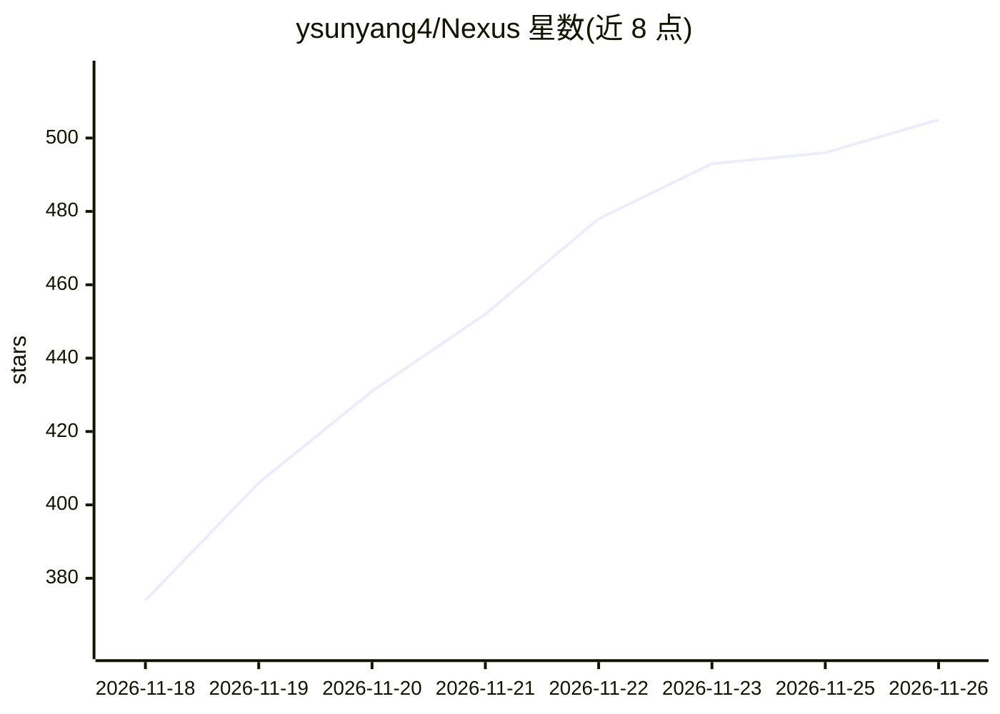

# ysunyang4/Nexus

⭐ 505 · TypeScript · AGPL-3.0 · 推送 2026-11-25 · [GitHub](https://github.com/ysunyang4/Nexus) · [官网](https://github.com/ysunyang4/Nexus) · 个人维护 · 中文 README

**通过 MCP 将网页 AI 助手连接到本地文件、终端与工具的控制面**

面向 ChatGPT、DeepSeek 等网页 AI 客户端的本地控制面：通过带 Bearer 令牌的 Secure MCP Tunnel（Streamable HTTP）将远程 LLM 接入本地工作站，提供 332 个定义在协议中的 MCP 工具，覆盖文件系统、Git、命令执行、浏览器自动化、Windows 计算机使用等 24 个维度。安全机制包括多级路径沙箱、ACID 写前日志账本、命令风险分级与敏感文件屏蔽。提供 Tauri 桌面控制中心安装包与浏览器用户脚本，源码构建需 Node.js >= 24、pnpm、Rust。

## 筛选速览

| 维度 | 判定 | 备注 |
|---|---|---|
| AI 角色 | `ai-ecosystem` | LLM/agent 周边工具 |
| 许可风险 | `viral` | AGPL-3.0 |
| 部署形态 | `desktop` | 安装包/桌面程序 |
| 模型依赖 | — | README 未给出锁定关系 |
| 硬件要求 | — | 无带数字的原话,不猜 |
| 安装摩擦 | `low` | 无编译、无系统依赖或容器化 |
| 成熟度 | — | 结构信号不足 |

## 能力要点

- 332 个形式化定义的 MCP 工具，覆盖 24 个能力维度
- ACID 写前日志（WAL）与崩溃恢复、幂等保护
- 多级路径沙箱、符号链接逃逸防护与敏感文件自动屏蔽
- AST 命令风险分级，默认拦截破坏性系统命令

## 适用场景

- 让网页版 AI 助手在授权沙箱内读写本地项目代码
- 通过 AI 代理执行本地终端命令与 Git 操作
- 在 Unity/Blender 编辑器中由 AI 代理生成场景与着色器
- 对 AI 代理的本地操作做细粒度权限与审计管理

## 场景标签

`浏览器自动化` `GUI 自动化` · 领域:效率与自动化

## 证据(README 行号)

> L5:  Dedicated Local AI Control Plane for ChatGPT, DeepSeek & Modern Web AI Assistants
> L19: **Nexus** is an enterprise-grade Local AI Control Plane designed specifically for ChatGPT, DeepSeek, and modern AI 
> L77: #### 1. 332 Canonical MCP Tools

## 星数曲线

2026-11-18 374 → 2026-11-26 505（+131）

---
*卡片 v1 · prompt 1.4 · 生成 2026-11-25 · 置信度 high · 依据 README sha `16787b89f04c` · [字段定义](../../DATASET.md)*
