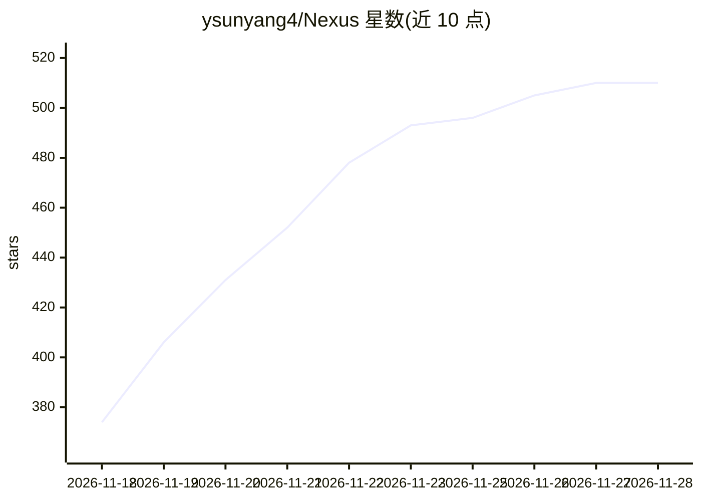

# ysunyang4/Nexus

⭐ 510 · TypeScript · AGPL-3.0 · 推送 2026-11-27 · [GitHub](https://github.com/ysunyang4/Nexus) · [官网](https://github.com/ysunyang4/Nexus) · 个人维护 · 中文 README

**本地 MCP 执行网关：让网页版 AI 操作本地文件、终端与 Git**

Nexus 是一个本地 MCP 执行网关，提供两种运行方式：一是通过 WebAgent 浏览器扩展把 ChatGPT、DeepSeek、Claude、Gemini、Kimi 等网页聊天接入本地仓库、终端、LSP、Git worktree 与构建流程，无需 API key；二是通过 Streamable HTTP MCP 端点（127.0.0.1:18080/mcp）为 Cursor、Claude Code 等原生客户端提供 Blender、Unity、Playwright、Windows Computer Use 等工具，并内置 token 节流机制。共提供 332 个规范化 MCP 工具，带操作日志 WAL、路径沙箱与权限控制。桌面端基于 Tauri 2 构建，AGPL-3.0 许可。

## 筛选速览

| 维度 | 判定 | 备注 |
|---|---|---|
| AI 角色 | `ai-ecosystem` | LLM/agent 周边工具 |
| 许可风险 | `viral` | AGPL-3.0 |
| 部署形态 | `desktop` | 安装包/桌面程序 |
| 模型依赖 | — | README 未给出锁定关系 |
| 硬件要求 | — | 无带数字的原话,不猜 |
| 安装摩擦 | `low` | 无编译、无系统依赖或容器化 |
| 成熟度 | — | 结构信号不足 |

## 能力要点

- 332 个规范化 MCP 工具，覆盖文件系统、Git、终端、浏览器自动化等 24 个能力维度
- 内置 Token Guardrail：按需发现工具、单轮批量执行、载荷卸载以减少上下文占用
- ACID 操作日志 WAL：写前日志、崩溃恢复与幂等防护
- 多级路径沙箱与敏感文件屏蔽，命令风险分级并默认阻断破坏性系统调用

## 适用场景

- 让网页版 AI 订阅直接操作本地代码仓库完成编写与测试修复
- 为 Cursor/Claude Code 等客户端接入桌面与 3D 工具
- AI 驱动的 Blender/Unity 场景与着色器生成
- Windows 桌面 UI 自动化与视觉验证

## 场景标签

`浏览器自动化` `GUI 自动化` `编码 Agent` · 领域:效率与自动化

## 证据(README 行号)

> L18: **Nexus** is a local MCP execution gateway with two ways to run—giving browser-based AI chats Codex-style workstati
> L25: |**⚡ Native Clients → Token-Lean & Supercharged** *(Cursor, Antigravity, Claude Code, Codex CLI, Windsurf)*|Connect

## 星数曲线

2026-11-18 374 → 2026-11-28 510（+136）

---
*卡片 v1 · prompt 1.4 · 生成 2026-11-28 · 置信度 high · 依据 README sha `2a28ef087e8f` · [字段定义](../../DATASET.md)*
