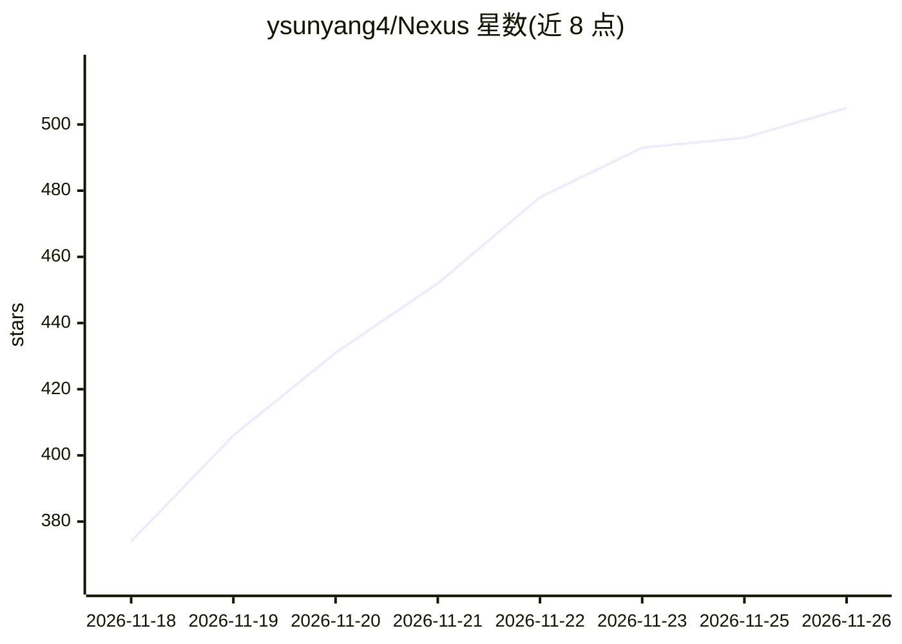

# ysunyang4/Nexus

⭐ 505 · TypeScript · AGPL-3.0 · 推送 2026-11-25 · [GitHub](https://github.com/ysunyang4/Nexus) · [官网](https://github.com/ysunyang4/Nexus) · 个人维护 · 中文 README

**把网页 AI 助手接入本地文件/终端/Git/MCP 工具的控制面**

面向使用 ChatGPT、DeepSeek 等网页 AI 助手的开发者，通过 Secure MCP Tunnel（Streamable HTTP + Bearer token）将远程 LLM 接入本地工作站，提供 332 个规范化 MCP 工具，覆盖文件系统、Git、命令执行、浏览器自动化、Windows Computer Use 等维度。带桌面控制中心（Tauri 2）做权限治理与可观测性，配合路径沙箱、命令风险分级、WAL 操作日志与崩溃恢复。限制：部分能力（Windows Job Objects、DPAPI、NTFS junction 防护）面向 Windows。

## 筛选速览

| 维度 | 判定 | 备注 |
|---|---|---|
| AI 角色 | `ai-ecosystem` | LLM/agent 周边工具 |
| 许可风险 | `viral` | AGPL-3.0 |
| 部署形态 | `desktop` | 安装包/桌面程序 |
| 模型依赖 | — | README 未给出锁定关系 |
| 硬件要求 | — | 无带数字的原话,不猜 |
| 安装摩擦 | `low` | 无编译、无系统依赖或容器化 |
| 成熟度 | — | 结构信号不足 |

## 能力要点

- 332 个 MCP 工具，覆盖文件系统、Git、命令执行、LSP、浏览器自动化等 24 个能力维度
- 多级路径沙箱：目录穿越与符号链接逃逸防护、敏感文件自动遮蔽
- ACID 风格操作账本：WAL 预写日志、崩溃恢复、幂等防重
- Blender 3D 自动化与 Unity 编辑器内 Copilot 的 MCP 桥接

## 适用场景

- 让网页端 ChatGPT/DeepSeek 在沙箱边界内读写本地仓库、运行构建
- 授权 AI 助手执行终端命令与调试工作流并控制读写权限
- 通过对话驱动 Blender/Unity 生成 3D 场景与着色器

## 场景标签

`编码 Agent` · 领域:编码与开发

## 证据(README 行号)

> L7:  Dedicated Local AI Control Plane for ChatGPT, DeepSeek & Modern Web AI Assistants
> L16: Nexus is an enterprise-grade Local AI Control Plane designed specifically for ChatGPT, DeepSeek, and modern AI codi
> L77: - **Single Source of Truth**: All 332 tools are formally defined in `@localbridge/protocol`, with strict input sche

## 星数曲线

2026-11-18 374 → 2026-11-26 505（+131）

---
*卡片 v1 · prompt 1.4 · 生成 2026-11-26 · 置信度 high · 依据 README sha `706e5f825413` · [字段定义](../../DATASET.md)*
