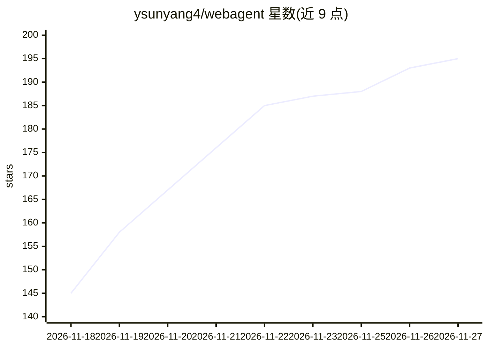

# ysunyang4/webagent

⭐ 195 · JavaScript · GPL-3.0 · 推送 2026-11-26 · [GitHub](https://github.com/ysunyang4/webagent) · [官网](https://github.com/ysunyang4/webagent/blob/main/USAGE.md) · 个人维护 · 中文 README

**浏览器扩展：把网页版 AI 对接本地 MCP 工具**

Chromium 浏览器扩展（Manifest V3），通过 MCP 协议和 Nexus 执行核心在浏览器内的 AI 聊天页面与本地系统之间建立桥接，使 DeepSeek、ChatGPT、Gemini、Kimi、Qwen 等网页模型可执行本地文件检查、shell 命令、代码编辑等操作，无需付费 API key。提供站点自适应注入、四层自愈解析器、隐私脱敏、速率限制与配额控制、跨会话自动接管等功能。安装方式为 git clone 后在浏览器开发者模式下加载。

## 筛选速览

| 维度 | 判定 | 备注 |
|---|---|---|
| AI 角色 | `ai-ecosystem` | LLM/agent 周边工具 |
| 许可风险 | `viral` | GPL-3.0 |
| 部署形态 | `None` |  |
| 模型依赖 | locked-api |  |
| 硬件要求 | — | 无带数字的原话,不猜 |
| 安装摩擦 | `low` | 无编译、无系统依赖或容器化 |
| 成熟度 | — | 结构信号不足 |

## 能力要点

- 通过 MCP 协议与 Nexus 执行核心桥接网页 AI 与本地系统
- 支持 14 个网页 AI 平台（DeepSeek/ChatGPT/Gemini/Kimi/Qwen 等）的站点自适应工具注入
- 通信锁定 127.0.0.1，自动脱敏 API key、密码与用户路径
- 支持英/简中/日/德四语言界面与跨会话自动接管

## 适用场景

- 不购买 API 的情况下让网页版模型执行本地命令和代码编辑
- 在本地闭环中处理不希望上传云端的项目代码
- 模型会话超长时自动打包上下文开新会话续跑任务

## 场景标签

`浏览器自动化` `编码 Agent` · 领域:效率与自动化

## 证据(README 行号)

> L19: **WebAgent 2.0** is an enterprise-grade, privacy-first Chromium browser extension designed to turn web-based Large 
> L21: By creating a secure, low-latency bridge between browser-based AI chats and your local system (via standard Model C
> L64: |Platform|Web Domain|Special Capabilities|

## 星数曲线

2026-11-18 145 → 2026-11-27 195（+50）

---
*卡片 v1 · prompt 1.4 · 生成 2026-11-26 · 置信度 high · 依据 README sha `9546a1a91901` · [字段定义](../../DATASET.md)*
