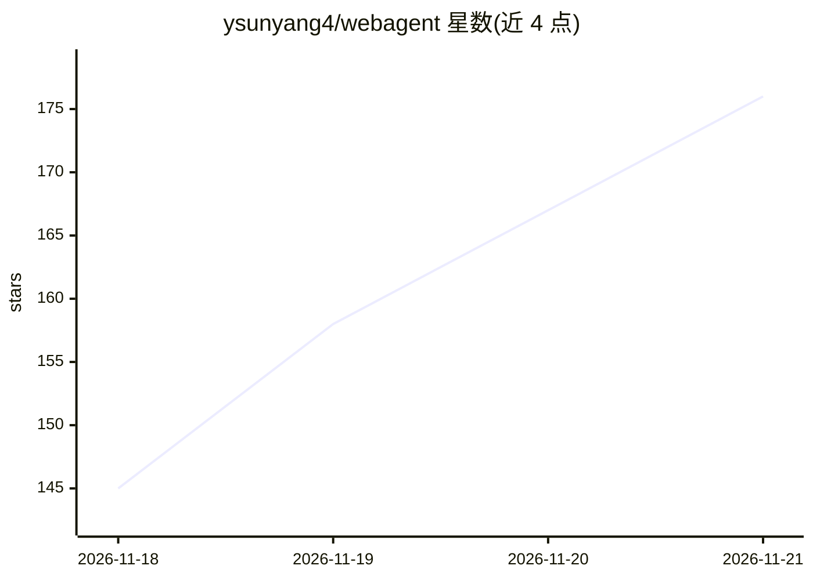

# ysunyang4/webagent

⭐ 176 · JavaScript · GPL-3.0 · 推送 2026-11-20 · [GitHub](https://github.com/ysunyang4/webagent) · [官网](https://github.com/ysunyang4/webagent/blob/main/USAGE.md) · 个人维护 · 中文 README

**让网页版大模型通过 MCP 调用本地工具的浏览器扩展**

面向 DeepSeek、Gemini、智谱、ChatGPT、Kimi 等网页版大模型的 Chromium 浏览器扩展：在对话页面注入浮动面板，将模型输出中的 nexus 代码块解析为标准 MCP 工具调用（文件读写、命令行、网页快照），经本地 Nexus 服务（默认 127.0.0.1:8787）执行后把结果回填到发送栏。自动执行与自动发送为独立开关，默认关闭；权限修改需 Nexus 管理令牌，仅扩展弹窗可操作。以开发者模式加载解压源码方式安装，运行需配合 Nexus 并注册项目，测试需 Node.js 22+。

## 筛选速览

| 维度 | 判定 | 备注 |
|---|---|---|
| AI 角色 | `ai-ecosystem` | LLM/agent 周边工具 |
| 许可风险 | `viral` | GPL-3.0 |
| 部署形态 | `None` |  |
| 模型依赖 | — | README 未给出锁定关系 |
| 硬件要求 | — | 无带数字的原话,不猜 |
| 安装摩擦 | `low` | 无编译、无系统依赖或容器化 |
| 成熟度 | — | 结构信号不足 |

## 能力要点

- 解析网页模型输出的 nexus 代码块为标准 MCP 工具调用并回填结果
- 适配 DeepSeek/Gemini/智谱/AI Studio/ChatGPT/Kimi 等多网页端
- 自动执行与自动发送独立开关，默认关闭，保留原草稿
- 权限修改需独立 Nexus 管理令牌，仅扩展弹窗可操作

## 适用场景

- 在网页版 AI 对话中让模型直接读写本地文件、执行命令
- 不用 API Key、复用网页账号获得工具调用能力
- 控制本地项目在允许权限范围内被网页 AI 操作

## 场景标签

`AI 助手` · 领域:对话与助手

## 证据(README 行号)

> L5: WebAgent 是一个专为网页端大模型（DeepSeek、Gemini、智谱 BigModel/清言/Z.ai、Google AI Studio、ChatGPT、Kimi、通义千问、豆包、Duck.ai、Dola 等）打造的浏览器
> L58: - **本地 MCP 桥接**：支持标准 MCP 工具调用（文件读写、命令行运行、网页快照等）。
> L67: 默认服务基址为 `http://127.0.0.1:8787`，请求使用 `/mcp`；也支持配置允许的本机 18080 / 21888 端口。先运行 Nexus 并注册项目，在弹窗填写实际项目 ID，再检测连接。网页端账号由用户

## 星数曲线

2026-11-18 145 → 2026-11-21 176（+31）

---
*卡片 v1 · prompt 1.4 · 生成 2026-11-18 · 置信度 high · 依据 README sha `178cfebae1ad` · [字段定义](../../DATASET.md)*
