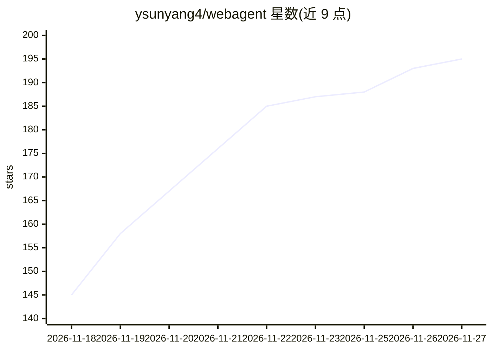

# ysunyang4/webagent

⭐ 195 · JavaScript · GPL-3.0 · 推送 2026-11-26 · [GitHub](https://github.com/ysunyang4/webagent) · [官网](https://github.com/ysunyang4/webagent/blob/main/USAGE.md) · 个人维护 · 中文 README

**把网页版 AI 对话接入本地 MCP 工具的浏览器扩展**

Chromium 浏览器扩展（Manifest V3，GPL-3.0），通过 MCP 协议与 Nexus 执行核心在网页 AI 聊天与本地系统之间建立桥接，让网页端 LLM 检查文件、运行 shell 命令、编辑代码、调用本地工具。无需付费 API key。适配 DeepSeek、ChatGPT、Gemini、Kimi、Qwen、豆包、Perplexity 等 13 个网页助手站点，提供自愈解析引擎、会话上下文超限自动开新对话续接、本地回环通信与出站数据脱敏、执行延迟与循环步数限制，内置英/简中/日/德四语言界面。安装方式为 git clone 后在浏览器开发者模式加载解压目录。

## 筛选速览

| 维度 | 判定 | 备注 |
|---|---|---|
| AI 角色 | `ai-ecosystem` | LLM/agent 周边工具 |
| 许可风险 | `viral` | GPL-3.0 |
| 部署形态 | `None` |  |
| 模型依赖 | locked-api |  |
| 硬件要求 | — | 无带数字的原话,不猜 |
| 安装摩擦 | `low` | 无编译、无系统依赖或容器化 |
| 成熟度 | — | 结构信号不足 |

## 能力要点

- 向 13 个网页 AI 助手注入站点自适应的工具执行钩子（MCP + Nexus）
- 本地回环 127.0.0.1 通信，无 API key、无外部遥测
- 出站正则脱敏 API key/密码/绝对路径，延迟与循环配额限流
- 会话上下文超限时自动打包状态开新对话续跑

## 适用场景

- 让网页版 DeepSeek/ChatGPT 直接操作本地文件与 shell 执行开发任务
- 不暴露代码给云端中间商的前提下使用订阅网页 AI 做本地自动化
- 长任务跨会话自动交接继续执行

## 场景标签

`AI 助手` `编码 Agent` `工作流自动化` · 领域:效率与自动化

## 证据(README 行号)

> L19: **WebAgent 2.0** is an enterprise-grade, privacy-first Chromium browser extension designed to turn web-based Large 
> L21: By creating a secure, low-latency bridge between browser-based AI chats and your local system (via standard Model C
> L64: |Platform|Web Domain|Special Capabilities|

## 星数曲线

2026-11-18 145 → 2026-11-27 195（+50）

---
*卡片 v1 · prompt 1.4 · 生成 2026-11-27 · 置信度 high · 依据 README sha `542027b24d09` · [字段定义](../../DATASET.md)*
