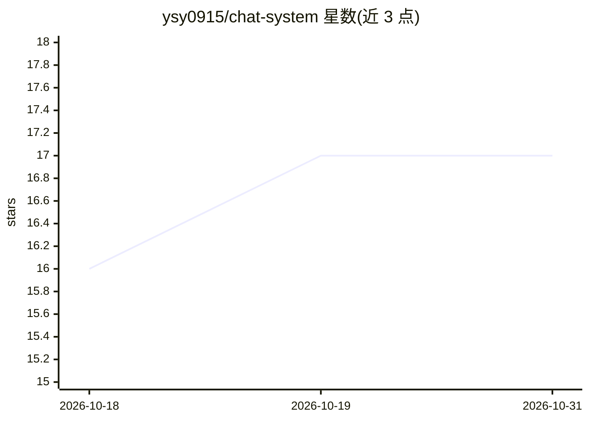

# ysy0915/chat-system

⭐ 17 · Java · Apache-2.0 · 推送 2026-10-26 · [GitHub](https://github.com/ysy0915/chat-system) · [官网](http://yangsy.online/chat/home) · 组织维护 · 中文 README

**多模型辩论协作平台：多 AI 组队辩论、共创完成任务**

基于 Spring Boot + React 的多模型智能协作平台：让豆包、DeepSeek、千问等多个模型同时参与对话、标准/树状辩论与协作。集成 RAG 知识库（Milvus 向量检索）、知识图谱抽取、多模态生成（文生图/视频/3D）、Multi-Agent 并行工作流（RabbitMQ 分发）。后端含独立的 chat-llm 服务，可零外部依赖 standalone 模式部署为纯内存 LLM 网关。提供 Docker Compose 一键部署与在线体验站点。

## 筛选速览

| 维度 | 判定 | 备注 |
|---|---|---|
| AI 角色 | `ai-native` | 本体是模型或模型工具 |
| 许可风险 | `permissive` | Apache-2.0 |
| 部署形态 | `self-host` | docker 或自建部署 |
| 模型依赖 | locked-api |  |
| 硬件要求 | — | 无带数字的原话,不猜 |
| 安装摩擦 | `low` | 无编译、无系统依赖或容器化 |
| 成熟度 | — | 结构信号不足 |

## 能力要点

- 3~6 个模型组队的标准辩论与 Plan-and-Execute 树状辩论
- 上传文档构建 Milvus RAG 知识库，意图驱动自动检索增强
- Multi-Agent 子任务 RabbitMQ 分发并行执行，含限流/死信重试/对账
- chat-llm 可纯内存零依赖独立部署，兼作 LLM 网关

## 适用场景

- 让多个 AI 模型就同一问题辩论并给出裁决式汇总
- 搭建私有知识库问答与知识图谱可视化
- 将长文/跨域请求拆解为子任务并行处理

## 场景标签

`多智能体` `文档问答` `知识图谱` `多模态` · 领域:Agent 开发

## 证据(README 行号)

> L22: 博思AI智能体是一个**多模型智能协作平台**。不同于传统 AI 产品"一个模型回答一个问题"的单声道模式，博思AI 让**豆包、DeepSeek、千问**等多个大模型同时参与对话、展开辩论、协作完成复杂任务，并融合 RAG 知识
> L47: - **标准辩论**：从已配置 chat 模型随机抽取 **3~6 个模型组队**（模型数可自选，名称中文展示），场次可选 1~10 轮，每轮反思修正 + 裁决式汇总；支持 Redis 外存**跨会话记忆**（同话题二次辩论首轮即

## 星数曲线

2026-10-18 16 → 2026-10-31 17（+1）

---
*卡片 v1 · prompt 1.4 · 生成 2026-10-29 · 置信度 high · 依据 README sha `cb6c6011cf91` · [字段定义](../../DATASET.md)*
