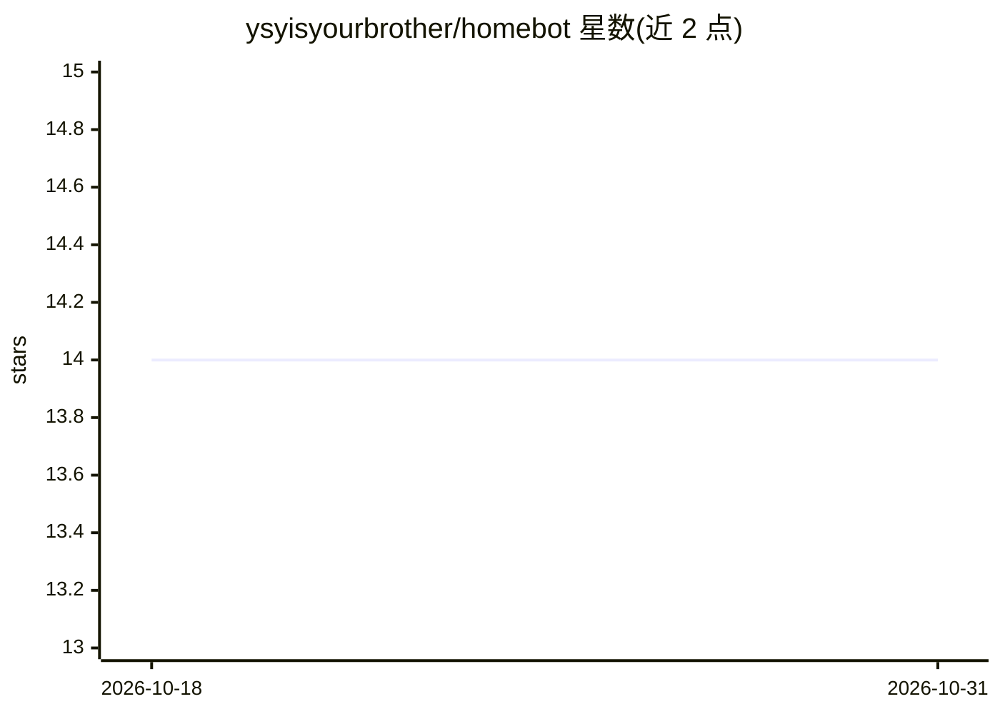

# ysyisyourbrother/homebot

⭐ 14 · Python · MIT · 推送 2026-10-26 · [GitHub](https://github.com/ysyisyourbrother/homebot) · [官网](https://ysyisyourbrother.github.io/homebot/) · 个人维护 · 中文 README

**本地部署的语音驱动个人 AI 代理，用于对话式家居自动化**

Homebot 是一个可本地部署的个人 AI agent：通过自定义唤醒词、说话人验证、流式语音识别与 TTS 提供自然语音交互，支持飞书、Telegram 与本地语音多渠道并行接入共享同一个 Agent。模型侧兼容 OpenAI 类服务（DeepSeek、OpenRouter、Qwen、智谱），内置复用 DeepSeek 凭据的联网搜索；技能覆盖小米米家设备控制、音乐播放、天气查询、小红书搜索等。要求 Python 3.11 及以上，运行于既有电脑，架构模块化便于扩展新技能；安装与配置细节在外部文档站。附带 arXiv 技术报告可引用。

## 筛选速览

| 维度 | 判定 | 备注 |
|---|---|---|
| AI 角色 | `ai-native` | 本体是模型或模型工具 |
| 许可风险 | `permissive` | MIT |
| 部署形态 | `None` |  |
| 模型依赖 | locked-api |  |
| 硬件要求 | — | 无带数字的原话,不猜 |
| 安装摩擦 | `low` | 无编译、无系统依赖或容器化 |
| 成熟度 | — | 结构信号不足 |

## 能力要点

- 自定义唤醒词、说话人验证、流式语音识别与 TTS 的语音交互
- 飞书/Telegram/本地语音多渠道并行共享一个 Agent
- 兼容 OpenAI 类模型服务（DeepSeek、OpenRouter、Qwen、智谱）
- 内置复用 DeepSeek 凭据的联网搜索，无需额外搜索 API key

## 适用场景

- 用语音或聊天软件控制小米米家等智能家居设备
- 通过飞书或 Telegram 与同一个个人 AI 助手持续对话
- 在自家电脑上本地部署并自定义扩展工具与技能

## 场景标签

`AI 助手` `语音 Agent` · 领域:对话与助手

## 证据(README 行号)

> L18: - **Natural voice interaction** with custom wake words, speaker verification, streaming speech recognition, and tex
> L22: - **Smart-home skills** for tasks such as controlling Xiaomi Mi Home devices, playing music, checking weather, and 

## 星数曲线

2026-10-18 14 → 2026-10-31 14（+0）

---
*卡片 v1 · prompt 1.4 · 生成 2026-10-31 · 置信度 high · 依据 README sha `b7a99445d576` · [字段定义](../../DATASET.md)*
