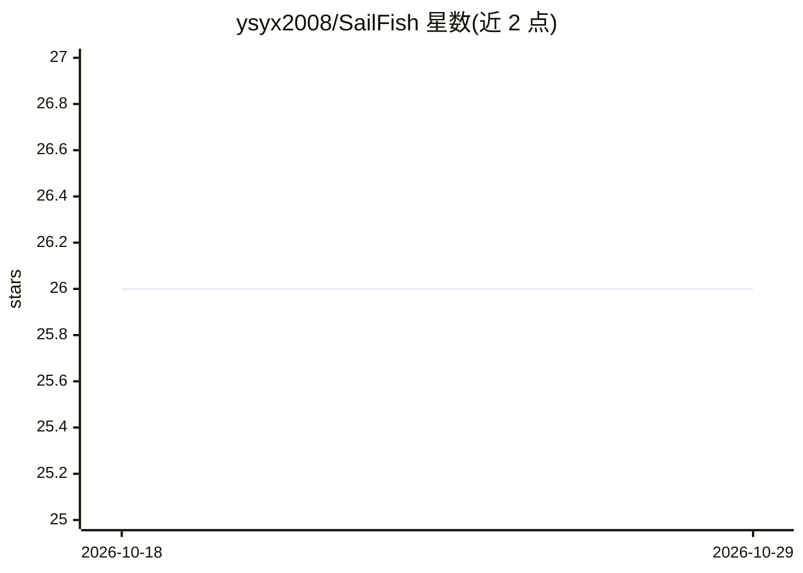

# ysyx2008/SailFish

⭐ 26 · TypeScript · NOASSERTION · 推送 2026-10-26 · [GitHub](https://github.com/ysyx2008/SailFish) · [官网](http://www.sfterm.com) · 个人维护 · 中文 README

**带记忆与主动触达能力的桌面个人 AI 秘书应用**

基于 Electron/Vue 的 macOS/Windows 桌面 AI 秘书应用：以自然语言指派任务（Tasks）或保持持续联系（Reach），可操作本机与 SSH 终端、读写文件、控制浏览器、收发邮件、管理日历与文档。内置三层记忆、本地知识库、Watch 心跳/文件监视等主动监控，通过微信/钉钉/飞书/Slack/Telegram 多渠道触达用户。不内置模型，用户自带 API key（含 Ollama 本地预设）；提供技能市场、MCP 连接器与 CLI。AGPL v3 开源另提供商业许可。

## 筛选速览

| 维度 | 判定 | 备注 |
|---|---|---|
| AI 角色 | `ai-native` | 本体是模型或模型工具 |
| 许可风险 | `none` | NOASSERTION |
| 部署形态 | `desktop` | 安装包/桌面程序 |
| 模型依赖 | local-ok | 支持本地模型 |
| 硬件要求 | — | 无带数字的原话,不猜 |
| 安装摩擦 | `low` | 无编译、无系统依赖或容器化 |
| 成熟度 | — | 结构信号不足 |

## 能力要点

- 任务（Tasks）与持续联系（Reach）两种工作形态，多 IM 渠道汇入同一线
- 三层记忆 + 本地知识库，可查看与编辑
- 本地与 SSH 终端、浏览器控制、子 agent 批量派发
- 危险命令分级确认（strict/relaxed/free 三种模式）

## 适用场景

- 让 AI 秘书代为运行命令、操作文件和浏览器完成桌面工作
- 通过微信/钉钉等 IM 随时与同一个秘书保持联系
- 配置本地 Ollama 模型在内网或离线环境使用
- 用 sailfish CLI 无头运行后端处理任务

## 场景标签

`AI 助手` · 领域:对话与助手

## 证据(README 行号)

> L29: SailFish isn't a chatbot waiting for commands. It's a **personal secretary** living on your desktop — with its own 
> L33: |Chat-only AI can't act|Your secretary runs commands, reads/writes files, controls the browser, sends email, and ma
> L127: ### AI Configuration

## 星数曲线

2026-10-18 26 → 2026-10-29 26（+0）

---
*卡片 v1 · prompt 1.4 · 生成 2026-10-26 · 置信度 high · 依据 README sha `cb05f18ab740` · [字段定义](../../DATASET.md)*
