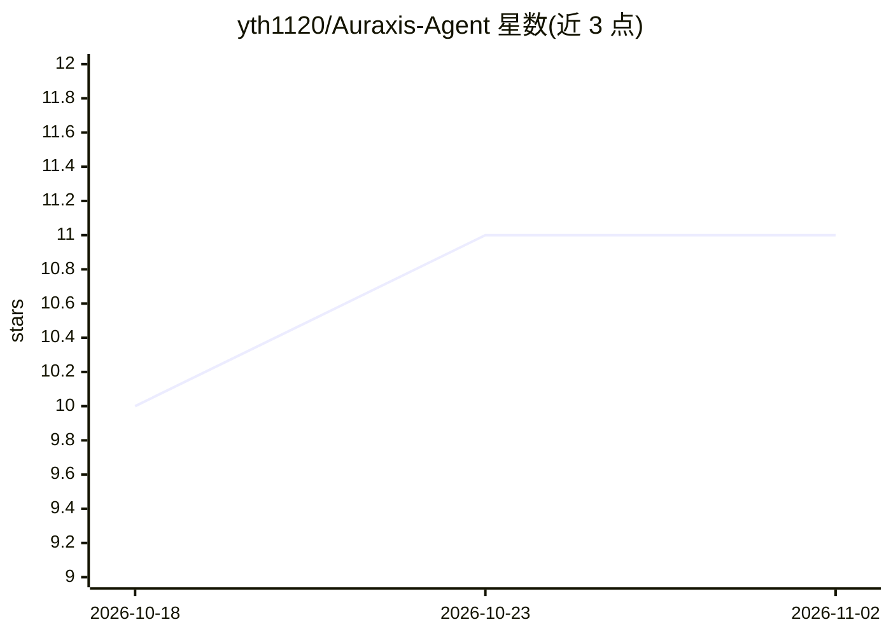

# yth1120/Auraxis-Agent

⭐ 11 · TypeScript · MIT · 推送 2026-10-26 · [GitHub](https://github.com/yth1120/Auraxis-Agent) · 个人维护 · 中文 README

**桌面端 AI 智能体工作台：多 Agent 调度与代码/文档/自动化**

基于 Electron + React 19 + TypeScript 的桌面应用，提供统一的 ReAct 步进引擎与多智能体调度，包含 Chat / Work / Code 三种工作模式、71+ 模型工具、权限/审批/沙箱管线、MCP 与飞书/DeepSeek 等连接器、Word/Excel/PPT/PDF 文档处理、终端与插件扩展，并支持本地账户、加密凭据与项目记忆全文检索。附 TypeScript 与 Python 两套 SDK，通过换行分隔的 JSON-RPC 2.0 驱动无头 runtime。从源码运行需 Node.js>=24 与 npm>=10，首次运行需配置 DEEPSEEK_API_KEY。

## 筛选速览

| 维度 | 判定 | 备注 |
|---|---|---|
| AI 角色 | `ai-native` | 本体是模型或模型工具 |
| 许可风险 | `permissive` | MIT |
| 部署形态 | `library` | 以包/库形式分发 |
| 模型依赖 | locked-api |  |
| 硬件要求 | — | 无带数字的原话,不猜 |
| 安装摩擦 | `low` | 无编译、无系统依赖或容器化 |
| 成熟度 | — | 结构信号不足 |

## 能力要点

- 统一 ReAct 步进引擎与多 Agent 调度，Chat / Work / Code 三种模式
- 71+ 模型工具，权限、审批、沙箱执行管线
- MCP、飞书/Lark、DeepSeek Harness 等连接器
- TypeScript 与 Python SDK 经 JSON-RPC 2.0 驱动无头 runtime

## 适用场景

- 在桌面端用多个智能体处理编码、文档与自动化任务
- 通过 MCP 与飞书/DeepSeek 连接器接入自有服务与模型
- 用 SDK 以程序化方式驱动 Auraxis 无头 runtime

## 场景标签

`多智能体` `编码 Agent` · 领域:Agent 开发

## 证据(README 行号)

> L8: Auraxis 是一个基于 Electron + React 19 + TypeScript 的桌面端 AI 智能体工作台，提供统一的 ReAct 步进引擎、多智能体调度、Code / Work 模式、MCP 连接器、文档处理、终端
> L16: - 统一聊天、多 Agent 与 Code Mode 执行链路

## 星数曲线

2026-10-18 10 → 2026-11-02 11（+1）

---
*卡片 v1 · prompt 1.4 · 生成 2026-11-01 · 置信度 high · 依据 README sha `a36802ce9dd6` · [字段定义](../../DATASET.md)*
